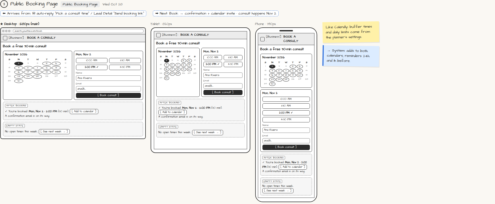

# Public Booking Page

> Generated from `app_outline/user_stories.md` by `pages/build_pages.py`. **Edit stories there**, then re-run the script; edits made here get overwritten.

**Role:** Client (Host) · **Phase:** P1 · **Stories:** CL-1.2, PL-2.4
**Route:** `Public Booking Page` · **URL:** `events.yourbiz.com/book` · **Wireframe snapshot:** Wed Oct 28

## Wireframe

Desktop, tablet and phone views plus design notes, cropped from `wireframes/wireframe.html`.

## How you get here, and where you go next

- ⬅ **Arrives from:** ✉ auto-reply "Pick a consult time" / Lead Detail "Send booking link"
- ➡ **Next:** Book → confirmation + calendar invite · consult happens Nov 2

## User stories

### CL-1.2 · Book a consult · P1

As a prospective client, I want to pick a consult time myself so that I don't wait for emails.  
_Screens: Public Booking Page_  
- [ ] See open slots; book with name and email
- [ ] Confirmation with [Add to calendar]; confirmation email and reminders 24h and 1h before
- [ ] No open times this week → [See next week]

### PL-2.4 · Consult booking · P1

As a planner, I want prospects to book a consult on my public availability page so that scheduling takes no back-and-forth.  
_Screens: Public Booking Page_  
- [ ] Shows only open slots, respecting buffer times, daily limits and external calendar busy times
- [ ] Booking adds the consult to both calendars and to Lead Detail; lead moves to "Consult booked"
- [ ] Reminders go to both people 24 hours and 1 hour before

## → System (backend jobs)

- → System: adds to both calendars; reminders 24h and 1h before.

## Design notes

- Like Calendly: buffer times and daily limits come from the planner's settings.

## Tests

See [`tests/README.md`](tests/README.md): one test per acceptance criterion.
