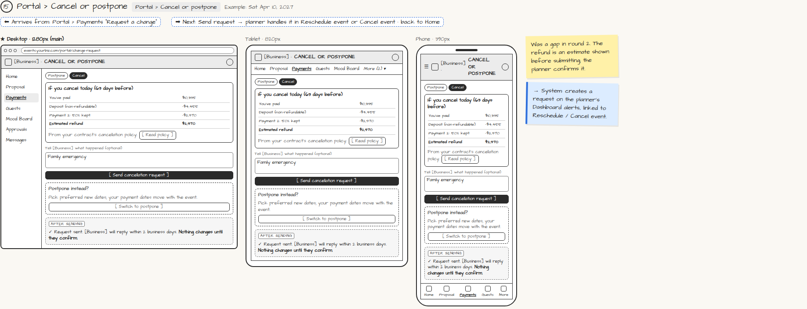

# Portal › Cancel or postpone

> Generated from `app_outline/user_stories.md` by `pages/build_pages.py`. **Edit stories there**, then re-run the script; edits made here get overwritten.

**Role:** Client (Host) · **Phase:** P1 · **Stories:** CL-4.4
**Route:** `Portal › Cancel or postpone` · **URL:** `events.yourbiz.com/portal/change-request` · **Wireframe snapshot:** Example: Sat Apr 10, 2027

## Wireframe

Desktop, tablet and phone views plus design notes, cropped from `wireframes/wireframe.html`.

## How you get here, and where you go next

- ⬅ **Arrives from:** Portal › Payments "Request a change"
- ➡ **Next:** Send request → planner handles it in Reschedule event or Cancel event · back to Home

## User stories

### CL-4.4 · Ask to cancel or postpone · P1

As a client, I want to request a cancellation or new date from the portal so that I know the consequences first.  
- [ ] Shows the contract's policy and refund estimate before I submit
- [ ] The planner handles it via PL-3.6 / PL-3.7

## → System (backend jobs)

- → System: creates a request on the planner's Dashboard alerts, linked to Reschedule / Cancel event.

## Design notes

- Was a gap in round 2. The refund is an estimate shown before submitting; the planner confirms it.

## Tests

See [`tests/README.md`](tests/README.md): one test per acceptance criterion.
