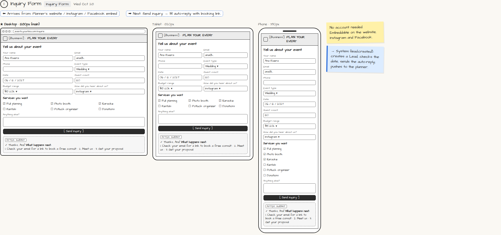

# Inquiry Form

> Generated from `app_outline/user_stories.md` by `pages/build_pages.py`. **Edit stories there**, then re-run the script; edits made here get overwritten.

**Role:** Client (Host) · **Phase:** P1 · **Stories:** CL-1.1
**Route:** `Inquiry Form` · **URL:** `events.yourbiz.com/inquire` · **Wireframe snapshot:** Wed Oct 28

## Wireframe

Desktop, tablet and phone views plus design notes, cropped from `wireframes/wireframe.html`.

## How you get here, and where you go next

- ⬅ **Arrives from:** Planner's website / Instagram / Facebook embed
- ➡ **Next:** Send inquiry → ✉ auto-reply with booking link

## User stories

### CL-1.1 · Send an inquiry without an account · P1

As a prospective client, I want to send my event details through a simple form so that I find out if the planner is available.  
_Screens: Inquiry Form, ✉ Inquiry auto-reply_  
- [ ] No account; works on the planner's website, Instagram and Facebook
- [ ] Fields: name, email, phone, event type, date, guest count, budget range, services, how they heard, notes
- [ ] Confirmation explains "what happens next"
- [ ] Auto-reply email arrives with a [Pick a consult time] link

## → System (backend jobs)

- → System (lead.created): creates a Lead, checks the date, sends the auto-reply, pushes to the planner.

## Design notes

- No account needed. Embeddable on the website, Instagram and Facebook.

## Related pages

Pages that share a story with this one:

- [✉ Inquiry auto-reply](../../messages/email-inquiry-auto-reply/)

## Tests

See [`tests/README.md`](tests/README.md): one test per acceptance criterion.
