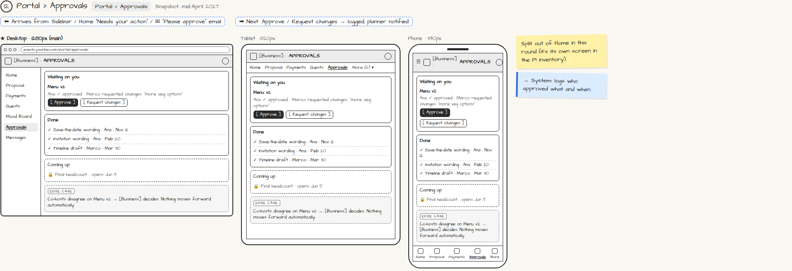

# Portal › Approvals

> Generated from `app_outline/user_stories.md` by `pages/build_pages.py`. **Edit stories there**, then re-run the script; edits made here get overwritten.

**Role:** Client (Host) · **Phase:** P1 · **Stories:** CL-3.5, CL-3.6
**Route:** `Portal › Approvals` · **URL:** `events.yourbiz.com/portal/approvals` · **Wireframe snapshot:** Snapshot: mid-April 2027

## Wireframe

Desktop, tablet and phone views plus design notes, cropped from `wireframes/wireframe.html`.

## How you get here, and where you go next

- ⬅ **Arrives from:** Sidebar / Home "Needs your action" / ✉ "Please approve" email
- ➡ **Next:** Approve / Request changes → logged; planner notified

## User stories

### CL-3.5 · Approve invitation wording · P1

As a client, I want to approve the invitation before it goes out so that it says what I want.  
_Screens: Portal › Approvals_  
- [ ] See the design and wording; [Approve] or [Request changes] with a comment

### CL-3.6 · Approvals · P1

As a client, I want one place to approve things so that decisions are clear and recorded.  
_Screens: Portal › Approvals · Events: headcount.locked (for final headcount)_  
- [ ] Waiting / Done / Coming up lists (e.g. menu, timeline, floor plan, final headcount)
- [ ] [Approve] or [Request changes] with comment; each response logged with who and when
- [ ] Co-hosts disagree: both names and responses shown; the planner decides; nothing proceeds automatically
- [ ] Final headcount approval opens on its date and triggers the planner's lock (PL-5.4)

## → System (backend jobs)

- → System: logs who approved what and when.

## Design notes

- Split out of Home in this round (it's its own screen in the P1 inventory).

## Tests

See [`tests/README.md`](tests/README.md): one test per acceptance criterion.
