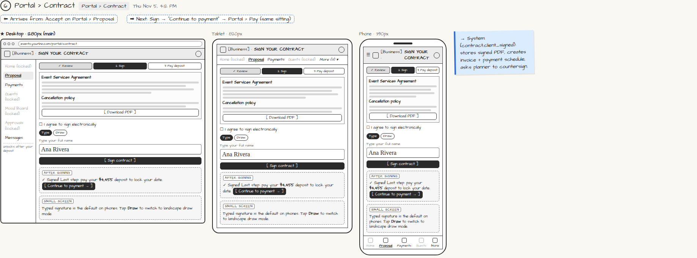

# Portal › Contract

> Generated from `app_outline/user_stories.md` by `pages/build_pages.py`. **Edit stories there**, then re-run the script; edits made here get overwritten.

**Role:** Client (Host) · **Phase:** P1 · **Stories:** CL-2.3
**Route:** `Portal › Contract` · **URL:** `events.yourbiz.com/portal/contract` · **Wireframe snapshot:** Thu Nov 5, 4:12 PM

## Wireframe

Desktop, tablet and phone views plus design notes, cropped from `wireframes/wireframe.html`.

## How you get here, and where you go next

- ⬅ **Arrives from:** Accept on Portal › Proposal
- ➡ **Next:** Sign → "Continue to payment" → Portal › Pay (same sitting)

## User stories

### CL-2.3 · Sign the contract · P1

As a client, I want to e-sign the contract on any device so that booking takes minutes.  
_Screens: Portal › Contract · Events: contract.client_signed_  
- [ ] Read the contract; [Download PDF]; agree to e-sign consent
- [ ] Typed signature (default on phones) or drawn signature (landscape draw mode on phones)
- [ ] After signing: "✓ Signed! Last step: pay your deposit" with [Continue to payment]

## → System (backend jobs)

- → System (contract.client_signed): stores signed PDF, creates invoice + payment schedule, asks planner to countersign.

## Tests

See [`tests/README.md`](tests/README.md): one test per acceptance criterion.
