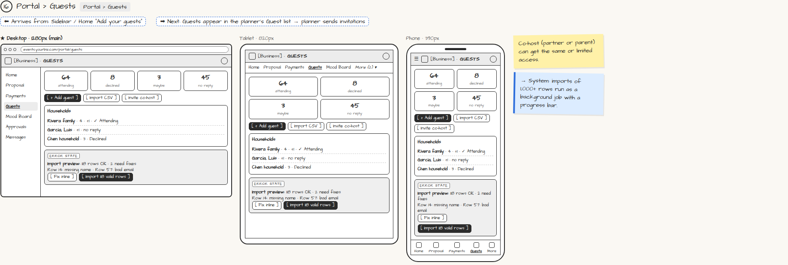

# Portal › Guests

> Generated from `app_outline/user_stories.md` by `pages/build_pages.py`. **Edit stories there**, then re-run the script; edits made here get overwritten.

**Role:** Client (Host) · **Phase:** P1 · **Stories:** CL-3.4
**Route:** `Portal › Guests` · **URL:** `events.yourbiz.com/portal/guests`

## Wireframe

Desktop, tablet and phone views plus design notes, cropped from `wireframes/wireframe.html`.

## How you get here, and where you go next

- ⬅ **Arrives from:** Sidebar / Home "Add your guests"
- ➡ **Next:** Guests appear in the planner's Guest list → planner sends invitations

## User stories

### CL-3.4 · Manage my guest list · P1

As a client, I want to add guests and households myself so that the planner doesn't have to retype my list.  
_Screens: Portal › Guests_  
- [ ] Add guests manually or by CSV; group households; set plus-ones; see RSVP stats
- [ ] CSV import preview flags bad rows (missing name, bad email), lets me fix them inline, and imports only valid rows
- [ ] [Invite co-host] (partner or parent) with the same or limited access

## → System (backend jobs)

- → System: imports of 1,000+ rows run as a background job with a progress bar.

## Design notes

- Co-host (partner or parent) can get the same or limited access.

## Tests

See [`tests/README.md`](tests/README.md): one test per acceptance criterion.
