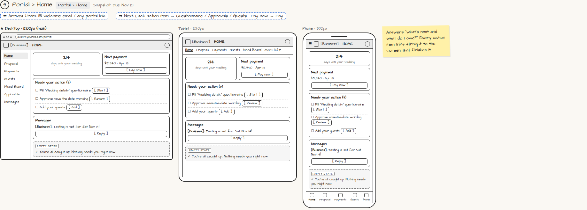

# Portal › Home

> Generated from `app_outline/user_stories.md` by `pages/build_pages.py`. **Edit stories there**, then re-run the script; edits made here get overwritten.

**Role:** Client (Host) · **Phase:** P1 · **Stories:** CL-3.1, CL-2.5
**Route:** `Portal › Home` · **URL:** `events.yourbiz.com/portal` · **Wireframe snapshot:** Snapshot: Tue Nov 10

## Wireframe

Desktop, tablet and phone views plus design notes, cropped from `wireframes/wireframe.html`.

## How you get here, and where you go next

- ⬅ **Arrives from:** ✉ welcome email / any portal link
- ➡ **Next:** Each action item → Questionnaire / Approvals / Guests · Pay now → Pay

## User stories

### CL-3.1 · Portal home · P1

As a client, I want my home screen to tell me what's next and what I owe so that I stop worrying.  
_Screens: Portal › Home_  
- [ ] Countdown, next payment with [Pay now], "Needs your action (n)" and recent messages
- [ ] Every action item links straight to the screen that finishes it
- [ ] Nothing pending → "You're all caught up"

### CL-2.5 · First portal visit · P1

As a new client, I want a short tour so that I know where things are.  
- [ ] 3-screen tour on first visit; skippable
- [ ] Optional prompt to set up a password or passkey

## Design notes

- Answers "what's next and what do I owe?" Every action item links straight to the screen that finishes it.

## Related pages

Pages that share a story with this one:

- [✉ Receipt + welcome](../../messages/email-receipt-welcome/)

## Tests

See [`tests/README.md`](tests/README.md): one test per acceptance criterion.
