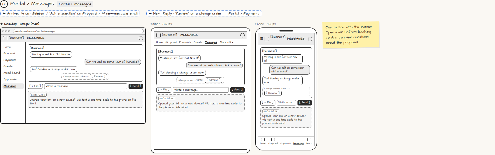

# Portal › Messages

> Generated from `app_outline/user_stories.md` by `pages/build_pages.py`. **Edit stories there**, then re-run the script; edits made here get overwritten.

**Role:** Client (Host) · **Phase:** P1 · **Stories:** CL-4.5
**Route:** `Portal › Messages` · **URL:** `events.yourbiz.com/portal/messages`

## Wireframe

Desktop, tablet and phone views plus design notes, cropped from `wireframes/wireframe.html`.

## How you get here, and where you go next

- ⬅ **Arrives from:** Sidebar / "Ask a question" on Proposal / ✉ new-message email
- ➡ **Next:** Reply · "Review" on a change order → Portal › Payments

## User stories

### CL-4.5 · Message my planner · P1

As a client, I want one message thread with my planner so that everything is in one place.  
_Screens: Portal › Messages_  
- [ ] Available before booking; attach files; email notice of new messages

## Design notes

- One thread with the planner. Open even before booking, so Ana can ask questions about the proposal.

## Tests

See [`tests/README.md`](tests/README.md): one test per acceptance criterion.
