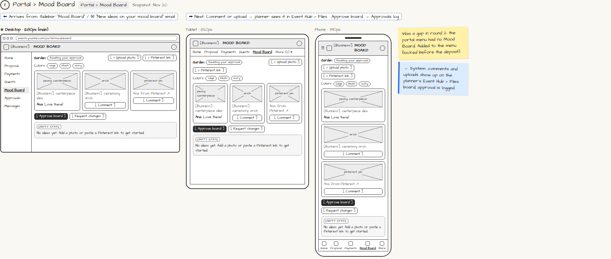

# Portal › Mood Board

> Generated from `app_outline/user_stories.md` by `pages/build_pages.py`. **Edit stories there**, then re-run the script; edits made here get overwritten.

**Role:** Client (Host) · **Phase:** P1 · **Stories:** CL-3.3
**Route:** `Portal › Mood Board` · **URL:** `events.yourbiz.com/portal/mood-board` · **Wireframe snapshot:** Snapshot: Nov 20

## Wireframe

Desktop, tablet and phone views plus design notes, cropped from `wireframes/wireframe.html`.

## How you get here, and where you go next

- ⬅ **Arrives from:** Sidebar "Mood Board" / ✉ "New ideas on your mood board" email
- ➡ **Next:** Comment or upload → planner sees it in Event Hub › Files · Approve board → Approvals log

## User stories

### CL-3.3 · Mood board · P1

As a client, I want to add inspiration and comment on the planner's ideas so that we agree on the look.  
- [ ] Upload photos, paste Pinterest links, comment on items

## → System (backend jobs)

- → System: comments and uploads show up on the planner's Event Hub › Files board; approval is logged.

## Design notes

- Was a gap in round 2: the portal menu had no Mood Board. Added to the menu (locked before the deposit).

## Tests

See [`tests/README.md`](tests/README.md): one test per acceptance criterion.
