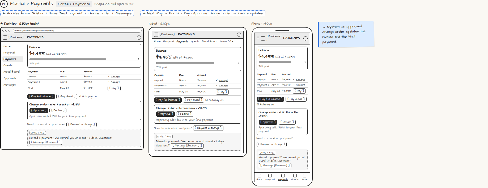

# Portal › Payments

> Generated from `app_outline/user_stories.md` by `pages/build_pages.py`. **Edit stories there**, then re-run the script; edits made here get overwritten.

**Role:** Client (Host) · **Phase:** P1 · **Stories:** CL-4.2, CL-4.3
**Route:** `Portal › Payments` · **URL:** `events.yourbiz.com/portal/payments` · **Wireframe snapshot:** Snapshot: mid-April 2027

## Wireframe

Desktop, tablet and phone views plus design notes, cropped from `wireframes/wireframe.html`.

## How you get here, and where you go next

- ⬅ **Arrives from:** Sidebar / Home "Next payment" / change order in Messages
- ➡ **Next:** Pay → Portal › Pay · Approve change order → invoice updates

## User stories

### CL-4.2 · Payments page · P1

As a client, I want to see what I've paid and what's left so that there are no surprises.  
_Screens: Portal › Payments_  
- [ ] Balance with progress bar; schedule with receipts for paid items
- [ ] [Pay full balance], [Pay ahead], autopay toggle

### CL-4.3 · Approve a change order · P1

As a client, I want to approve upgrades mid-planning (e.g. +1 hour karaoke) so that my invoice stays accurate.  
_Screens: Portal › Messages, Portal › Payments_  
- [ ] Change order shows item and price; [Approve] or [Decline]
- [ ] Approving updates the invoice and the next payment

## → System (backend jobs)

- → System: an approved change order updates the invoice and the final payment.

## Tests

See [`tests/README.md`](tests/README.md): one test per acceptance criterion.
