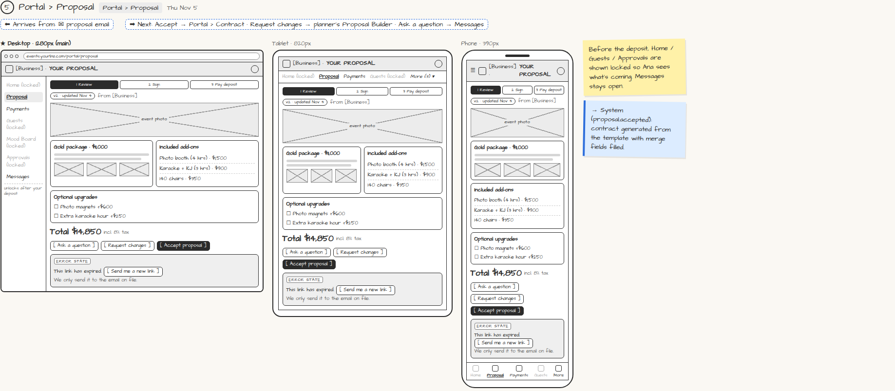

# Portal › Proposal

> Generated from `app_outline/user_stories.md` by `pages/build_pages.py`. **Edit stories there**, then re-run the script; edits made here get overwritten.

**Role:** Client (Host) · **Phase:** P1 · **Stories:** CL-2.1, CL-2.2
**Route:** `Portal › Proposal` · **URL:** `events.yourbiz.com/portal/proposal` · **Wireframe snapshot:** Thu Nov 5

## Wireframe

Desktop, tablet and phone views plus design notes, cropped from `wireframes/wireframe.html`.

## How you get here, and where you go next

- ⬅ **Arrives from:** ✉ proposal email
- ➡ **Next:** Accept → Portal › Contract · Request changes → planner's Proposal Builder · Ask a question → Messages

## User stories

### CL-2.1 · Open my proposal with a magic link · P1

As a client, I want to open my proposal from an email link with no password so that it's easy.  
_Screens: ✉ Your proposal, Portal › Proposal_  
- [ ] The link opens the portal directly; it expires in 7 days
- [ ] An expired link offers [Send me a new link], which goes only to the email on file
- [ ] A forwarded link or new device asks for a one-time code sent to the email/phone on file
- [ ] Before the deposit, Home / Guests / Approvals show as locked ("Unlocks after your deposit"); Messages is open

### CL-2.2 · Review and customize the proposal · P1

As a client, I want to see what's included and tick optional upgrades so that I understand the offer.  
_Screens: Portal › Proposal_  
- [ ] Package photos and inclusions; included add-ons; optional upgrades as checkboxes
- [ ] Total (with tax) updates live as I tick upgrades
- [ ] [Ask a question] opens Messages
- [ ] [Request changes] with a comment sends it to the planner; I always see the latest version
- [ ] Progress shown: Review → Sign → Pay deposit

## → System (backend jobs)

- → System (proposal.accepted): contract generated from the template with merge fields filled.

## Design notes

- Before the deposit, Home / Guests / Approvals are shown locked so Ana sees what's coming. Messages stays open.

## Related pages

Pages that share a story with this one:

- [✉ Your proposal (magic link)](../../messages/email-proposal/)

## Tests

See [`tests/README.md`](tests/README.md): one test per acceptance criterion.
