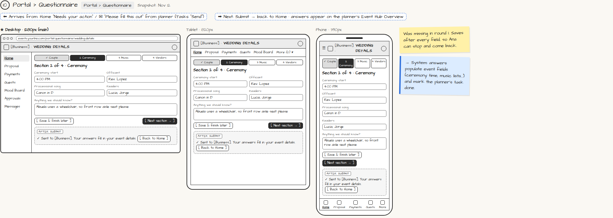

# Portal › Questionnaire

> Generated from `app_outline/user_stories.md` by `pages/build_pages.py`. **Edit stories there**, then re-run the script; edits made here get overwritten.

**Role:** Client (Host) · **Phase:** P1 · **Stories:** CL-3.2
**Route:** `Portal › Questionnaire` · **URL:** `events.yourbiz.com/portal/questionnaire/wedding-details` · **Wireframe snapshot:** Snapshot: Nov 12

## Wireframe

Desktop, tablet and phone views plus design notes, cropped from `wireframes/wireframe.html`.

## How you get here, and where you go next

- ⬅ **Arrives from:** Home "Needs your action" / ✉ "Please fill this out" from planner (Tasks "Send")
- ➡ **Next:** Submit → back to Home · answers appear on the planner's Event Hub Overview

## User stories

### CL-3.2 · Fill a questionnaire · P1

As a client, I want to answer the planner's questionnaire in sections so that I can do it in pieces.  
_Screens: Portal › Questionnaire_  
- [ ] Sections with progress; saves after every field; [Save & finish later]
- [ ] Submit returns me to Home; the planner sees "received"

## → System (backend jobs)

- → System: answers populate event fields (ceremony time, music lists…) and mark the planner's task done.

## Design notes

- Was missing in round 1. Saves after every field, so Ana can stop and come back.

## Tests

See [`tests/README.md`](tests/README.md): one test per acceptance criterion.
