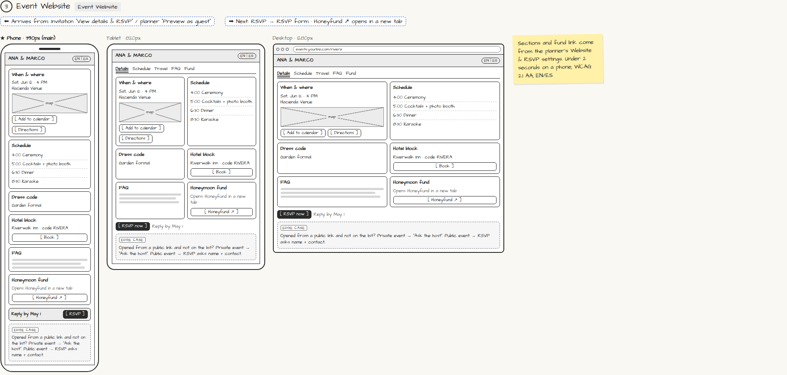

# Event Website

> Generated from `app_outline/user_stories.md` by `pages/build_pages.py`. **Edit stories there**, then re-run the script; edits made here get overwritten.

**Role:** Guest · **Phase:** P1 · **Stories:** GU-1.3, GU-2.3
**Route:** `Event Website` · **URL:** `events.yourbiz.com/rivera`

## Wireframe

Desktop, tablet and phone views plus design notes, cropped from `wireframes/wireframe.html`.

## How you get here, and where you go next

- ⬅ **Arrives from:** Invitation "View details & RSVP" / planner "Preview as guest"
- ➡ **Next:** RSVP → RSVP form · Honeyfund ↗ opens in a new tab

## User stories

### GU-1.3 · Event website · P1

As a guest, I want all the details on one page so that I know what, when and where.  
_Screens: Event Website_  
- [ ] Date, time, map, [Add to calendar], [Directions], schedule, dress code, hotel block, FAQ
- [ ] Registry/fund link opens the external site in a new tab (P1)
- [ ] [RSVP] always visible (sticky bar on phones)
- [ ] English/Spanish, following my browser language, with a toggle
- [ ] Loads in under 2 seconds on a phone (NFR-9); WCAG 2.1 AA (NFR-10)

### GU-2.3 · Public and private events · P1

As a guest who isn't on the list, I want to know what to do so that I'm not stuck.  
- [ ] Public event: the RSVP form asks for name and contact and creates a guest
- [ ] Private event: "Ask the host" message instead

## Design notes

- Sections and fund link come from the planner's Website & RSVP settings. Under 2 seconds on a phone; WCAG 2.1 AA; EN/ES.

## Related pages

Pages that share a story with this one:

- [RSVP](../../guest/rsvp/)

## Tests

See [`tests/README.md`](tests/README.md): one test per acceptance criterion.
