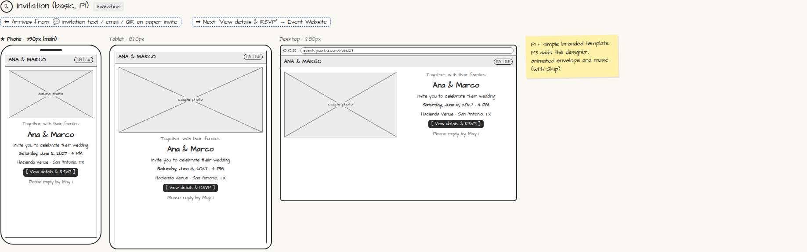

# Invitation (basic, P1)

> Generated from `app_outline/user_stories.md` by `pages/build_pages.py`. **Edit stories there**, then re-run the script; edits made here get overwritten.

**Role:** Guest · **Phase:** P1 · **Stories:** GU-1.2
**Route:** `Invitation` · **URL:** `events.yourbiz.com/i/abc123`

## Wireframe

Desktop, tablet and phone views plus design notes, cropped from `wireframes/wireframe.html`.

## How you get here, and where you go next

- ⬅ **Arrives from:** 💬 invitation text / email / QR on paper invite
- ➡ **Next:** "View details & RSVP" → Event Website

## User stories

### GU-1.2 · Open the invitation · P1 (basic) / P3 (designed)

As a guest, I want a nice-looking invitation so that I'm excited to come.  
_Screens: Invitation_  
- [ ] P1: branded template with names, date, time, venue, [View details & RSVP], reply-by date
- [ ] P3: animated envelope and music, always with Skip

## Design notes

- P1 = simple branded template. P3 adds the designer, animated envelope and music (with Skip).

## Tests

See [`tests/README.md`](tests/README.md): one test per acceptance criterion.
