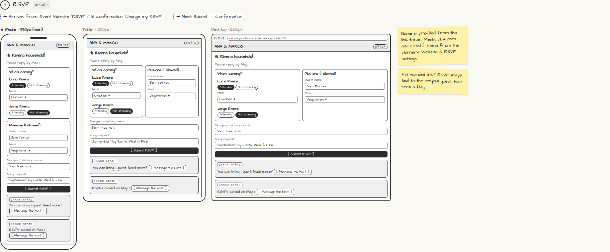

# RSVP

> Generated from `app_outline/user_stories.md` by `pages/build_pages.py`. **Edit stories there**, then re-run the script; edits made here get overwritten.

**Role:** Guest · **Phase:** P1 · **Stories:** GU-2.1, GU-2.3
**Route:** `RSVP` · **URL:** `events.yourbiz.com/rivera/rsvp?t=abc123`

## Wireframe

Desktop, tablet and phone views plus design notes, cropped from `wireframes/wireframe.html`.

## How you get here, and where you go next

- ⬅ **Arrives from:** Event Website "RSVP" / ✉ confirmation "Change my RSVP"
- ➡ **Next:** Submit → Confirmation

## User stories

### GU-2.1 · RSVP for my household · P1

As a guest, I want to RSVP for everyone in my household in one go so that it's quick.  
_Screens: RSVP · Events: rsvp.updated_  
- [ ] My name and household are prefilled from the token
- [ ] Attending / Not attending per member; meal choice per attendee; allergies/dietary notes; song request; custom questions
- [ ] Plus-one field appears only if allowed; I can't add more than allowed, with a polite explanation and [Message the host]
- [ ] A forwarded link still records the RSVP against the original guest; the host sees a "forwarded link" flag
- [ ] Guests marked as children: no data capture from them

### GU-2.3 · Public and private events · P1

As a guest who isn't on the list, I want to know what to do so that I'm not stuck.  
- [ ] Public event: the RSVP form asks for name and contact and creates a guest
- [ ] Private event: "Ask the host" message instead

## Design notes

- Name is prefilled from the link token. Meals, plus-ones and cutoff come from the planner's Website & RSVP settings.
- Forwarded link? RSVP stays tied to the original guest; host sees a flag.

## Related pages

Pages that share a story with this one:

- [Event Website](../../guest/event-website/)

## Tests

See [`tests/README.md`](tests/README.md): one test per acceptance criterion.
