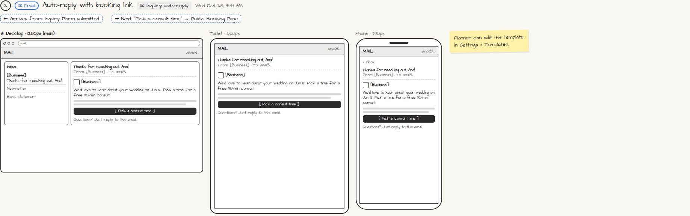

# ✉ Inquiry auto-reply

> Generated from `app_outline/user_stories.md` by `pages/build_pages.py`. **Edit stories there**, then re-run the script; edits made here get overwritten.

**Role:** Messages (email / text / push) · **Phase:** P1 · **Stories:** CL-1.1, PL-2.1
**Route:** `✉ Inquiry auto-reply` · **Wireframe snapshot:** Wed Oct 28, 9:41 AM

## Wireframe

Desktop, tablet and phone views plus design notes, cropped from `wireframes/wireframe.html`.

## How you get here, and where you go next

- ⬅ **Arrives from:** Inquiry Form submitted
- ➡ **Next:** "Pick a consult time" → Public Booking Page

## User stories

### CL-1.1 · Send an inquiry without an account · P1

As a prospective client, I want to send my event details through a simple form so that I find out if the planner is available.  
_Screens: Inquiry Form, ✉ Inquiry auto-reply_  
- [ ] No account; works on the planner's website, Instagram and Facebook
- [ ] Fields: name, email, phone, event type, date, guest count, budget range, services, how they heard, notes
- [ ] Confirmation explains "what happens next"
- [ ] Auto-reply email arrives with a [Pick a consult time] link

### PL-2.1 · New inquiries become leads automatically · P1

As a planner, I want every inquiry form submission to become a lead automatically so that I never miss an inquiry.  
_Screens: Inquiry Form (client), 🔔 New lead push, Leads · Events: lead.created_  
- [ ] A lead is created with event type, date, guest count, budget, services and source
- [ ] The requested date is checked against my calendar
- [ ] The prospect gets the auto-reply email with my booking link
- [ ] I get a push notification and a Dashboard card; tapping either opens Lead Detail

## Design notes

- Planner can edit this template in Settings › Templates.

## Related pages

Pages that share a story with this one:

- [Inquiry Form](../../client/inquiry-form/)
- [🔔 New lead notification](../../messages/push-new-lead/)

## Tests

See [`tests/README.md`](tests/README.md): one test per acceptance criterion.
