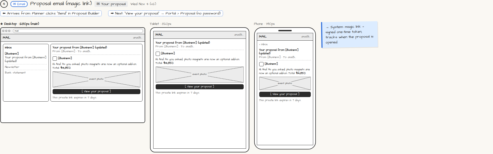

# ✉ Your proposal (magic link)

> Generated from `app_outline/user_stories.md` by `pages/build_pages.py`. **Edit stories there**, then re-run the script; edits made here get overwritten.

**Role:** Messages (email / text / push) · **Phase:** P1 · **Stories:** CL-2.1, PL-3.2
**Route:** `✉ Your proposal` · **Wireframe snapshot:** Wed Nov 4 (v2)

## Wireframe

Desktop, tablet and phone views plus design notes, cropped from `wireframes/wireframe.html`.

## How you get here, and where you go next

- ⬅ **Arrives from:** Planner clicks "Send" in Proposal Builder
- ➡ **Next:** "View your proposal" → Portal › Proposal (no password)

## User stories

### CL-2.1 · Open my proposal with a magic link · P1

As a client, I want to open my proposal from an email link with no password so that it's easy.  
_Screens: ✉ Your proposal, Portal › Proposal_  
- [ ] The link opens the portal directly; it expires in 7 days
- [ ] An expired link offers [Send me a new link], which goes only to the email on file
- [ ] A forwarded link or new device asks for a one-time code sent to the email/phone on file
- [ ] Before the deposit, Home / Guests / Approvals show as locked ("Unlocks after your deposit"); Messages is open

### PL-3.2 · Send a proposal and handle changes · P1

As a planner, I want to preview, send and revise proposals so that the client always sees the right version.  
_Screens: Proposal Builder, ✉ Proposal email (client) · Events: proposal sent, proposal opened_  
- [ ] [Preview as client] shows exactly what the client will see
- [ ] [Send] emails a magic link; lead moves to "Proposal sent"; I can see when it was opened
- [ ] Client change requests appear on the proposal with their comment
- [ ] Each send creates a new version (v1, v2…); old versions are kept; the client always sees the latest

## → System (backend jobs)

- → System: magic link = signed one-time token; tracks when the proposal is opened.

## Related pages

Pages that share a story with this one:

- [Proposal Builder](../../planner/proposal-builder/)
- [Portal › Proposal](../../client/portal-proposal/)

## Tests

See [`tests/README.md`](tests/README.md): one test per acceptance criterion.
