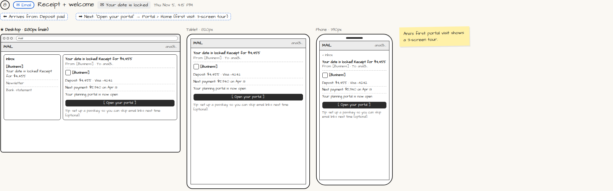

# ✉ Receipt + welcome

> Generated from `app_outline/user_stories.md` by `pages/build_pages.py`. **Edit stories there**, then re-run the script; edits made here get overwritten.

**Role:** Messages (email / text / push) · **Phase:** P1 · **Stories:** CL-2.4, CL-2.5
**Route:** `✉ Your date is locked` · **Wireframe snapshot:** Thu Nov 5, 4:15 PM

## Wireframe

Desktop, tablet and phone views plus design notes, cropped from `wireframes/wireframe.html`.

## How you get here, and where you go next

- ⬅ **Arrives from:** Deposit paid
- ➡ **Next:** "Open your portal" → Portal › Home (first visit: 3-screen tour)

## User stories

### CL-2.4 · Pay the deposit right after signing · P1

As a client, I want to pay my deposit on the same visit I sign so that my date is locked immediately.  
_Screens: Portal › Pay, ✉ Your date is locked · Events: payment.succeeded, payment.failed_  
- [ ] Shows the deposit and the full payment schedule
- [ ] Pay by card, Apple Pay, Google Pay or ACH; optional autopay for future payments
- [ ] If payments aren't connected: "pay by check/cash" instructions only
- [ ] Payment fails: plain-language error, "nothing was charged", [Try again] [Use another method]; planner alerted after 2 failures
- [ ] A double tap never charges twice (NFR-6)
- [ ] Success: "Your date is locked!", receipt email, portal unlocks, [Go to your portal]

### CL-2.5 · First portal visit · P1

As a new client, I want a short tour so that I know where things are.  
- [ ] 3-screen tour on first visit; skippable
- [ ] Optional prompt to set up a password or passkey

## Design notes

- Ana's first portal visit shows a 3-screen tour.

## Related pages

Pages that share a story with this one:

- [Portal › Pay](../../client/portal-pay/)
- [Portal › Home](../../client/portal-home/)

## Tests

See [`tests/README.md`](tests/README.md): one test per acceptance criterion.
