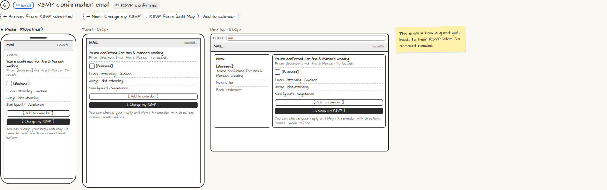

# ✉ RSVP confirmation

> Generated from `app_outline/user_stories.md` by `pages/build_pages.py`. **Edit stories there**, then re-run the script; edits made here get overwritten.

**Role:** Messages (email / text / push) · **Phase:** P1 · **Stories:** GU-2.2
**Route:** `✉ RSVP confirmed`

## Wireframe

Desktop, tablet and phone views plus design notes, cropped from `wireframes/wireframe.html`.

## How you get here, and where you go next

- ⬅ **Arrives from:** RSVP submitted
- ➡ **Next:** "Change my RSVP" → RSVP form (until May 1) · Add to calendar

## User stories

### GU-2.2 · Confirmation and changes · P1

As a guest, I want a confirmation and a way to change my RSVP so that I can fix mistakes.  
_Screens: RSVP Confirmation, ✉ RSVP confirmed_  
- [ ] Confirmation screen summarizes my reply, with [Add to calendar] and links to the fund (and potluck when on)
- [ ] Confirmation email/text with [Change my RSVP], which works until the cutoff
- [ ] After the cutoff: "RSVPs are closed" with [Message the host], unless the host allows late RSVPs

## Design notes

- This email is how a guest gets back to their RSVP later. No account needed.

## Related pages

Pages that share a story with this one:

- [RSVP Confirmation](../../guest/rsvp-confirmation/)

## Tests

See [`tests/README.md`](tests/README.md): one test per acceptance criterion.
