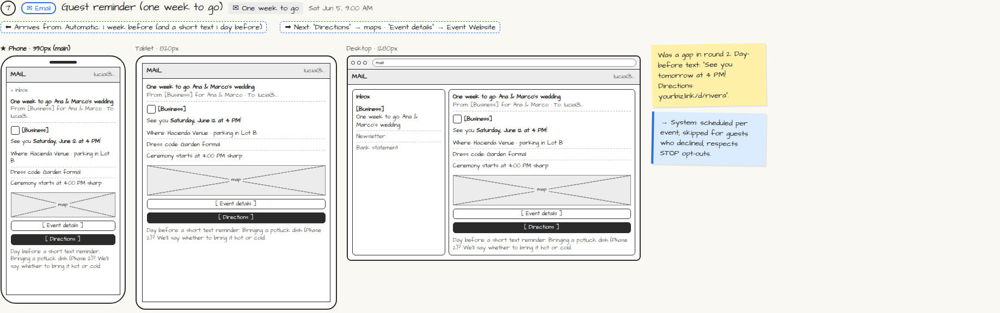

# ✉ Guest reminders (1 week + day before)

> Generated from `app_outline/user_stories.md` by `pages/build_pages.py`. **Edit stories there**, then re-run the script; edits made here get overwritten.

**Role:** Messages (email / text / push) · **Phase:** P1 · **Stories:** GU-4.1
**Route:** `✉ One week to go` · **Wireframe snapshot:** Sat Jun 5, 9:00 AM

## Wireframe

Desktop, tablet and phone views plus design notes, cropped from `wireframes/wireframe.html`.

## How you get here, and where you go next

- ⬅ **Arrives from:** Automatic: 1 week before (and a short text 1 day before)
- ➡ **Next:** "Directions" → maps · "Event details" → Event Website

## User stories

### GU-4.1 · Reminders · P1

As a guest, I want reminders before the event so that I know how to get there.  
- [ ] One week out: directions, parking, dress code (and potluck drop-off when on)
- [ ] Day before: reminder; potluck contributors get the hot/cold note

## → System (backend jobs)

- → System: scheduled per event; skipped for guests who declined; respects STOP opt-outs.

## Design notes

- Was a gap in round 2. Day-before text: "See you tomorrow at 4 PM! Directions: yourbiz.link/d/rivera".

## Tests

See [`tests/README.md`](tests/README.md): one test per acceptance criterion.
