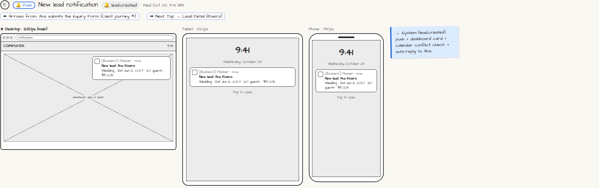

# 🔔 New lead notification

> Generated from `app_outline/user_stories.md` by `pages/build_pages.py`. **Edit stories there**, then re-run the script; edits made here get overwritten.

**Role:** Messages (email / text / push) · **Phase:** P1 · **Stories:** PL-2.1
**Route:** `🔔 lead.created` · **Wireframe snapshot:** Wed Oct 28, 9:41 AM

## Wireframe

Desktop, tablet and phone views plus design notes, cropped from `wireframes/wireframe.html`.

## How you get here, and where you go next

- ⬅ **Arrives from:** Ana submits the Inquiry Form (Client journey #1)
- ➡ **Next:** Tap → Lead Detail (Rivera)

## User stories

### PL-2.1 · New inquiries become leads automatically · P1

As a planner, I want every inquiry form submission to become a lead automatically so that I never miss an inquiry.  
_Screens: Inquiry Form (client), 🔔 New lead push, Leads · Events: lead.created_  
- [ ] A lead is created with event type, date, guest count, budget, services and source
- [ ] The requested date is checked against my calendar
- [ ] The prospect gets the auto-reply email with my booking link
- [ ] I get a push notification and a Dashboard card; tapping either opens Lead Detail

## → System (backend jobs)

- → System (lead.created): push + dashboard card + calendar conflict check + auto-reply to Ana.

## Related pages

Pages that share a story with this one:

- [✉ Inquiry auto-reply](../../messages/email-inquiry-auto-reply/)

## Tests

See [`tests/README.md`](tests/README.md): one test per acceptance criterion.
