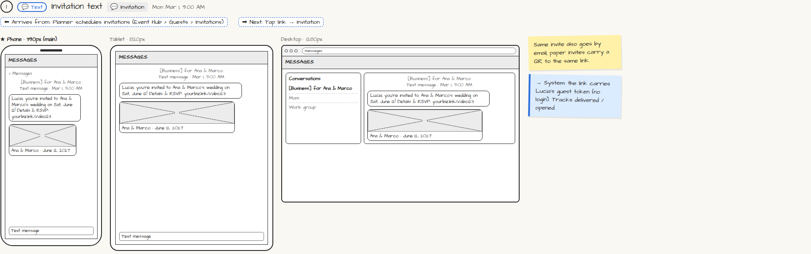

# 💬 Invitation text

> Generated from `app_outline/user_stories.md` by `pages/build_pages.py`. **Edit stories there**, then re-run the script; edits made here get overwritten.

**Role:** Messages (email / text / push) · **Phase:** P1 · **Stories:** GU-1.1, PL-5.3
**Route:** `💬 Invitation` · **Wireframe snapshot:** Mon Mar 1, 9:00 AM

## Wireframe

Desktop, tablet and phone views plus design notes, cropped from `wireframes/wireframe.html`.

## How you get here, and where you go next

- ⬅ **Arrives from:** Planner schedules invitations (Event Hub › Guests › Invitations)
- ➡ **Next:** Tap link → Invitation

## User stories

### GU-1.1 · Receive my invitation · P1

As a guest, I want my invitation by text, email or QR code so that I don't need an app or account.  
_Screens: 💬 Invitation_  
- [ ] Message preview shows host names and event title
- [ ] The link carries my unique token, so I'm recognized without logging in
- [ ] Paper invites and flyers carry a QR code to the same page

### PL-5.3 · Send invitations · P1 (simple template) / P3 (designer)

As a planner, I want to send save-the-dates and invitations by email, text or link so that guests get invited without paper chaos.  
_Screens: Event Hub › Guests › Invitations, 💬 Invitation (guest)_  
- [ ] Types: save-the-date, invitation, reminder, thank-you, all from the same design
- [ ] P1: one simple branded template with editable wording; P3: full Invitation Designer (PL-5.5)
- [ ] [Request client approval] sends the wording to Portal › Approvals; shows "Approved by [name] · date"
- [ ] Channels: email, SMS, shareable link + QR (for print and social); WhatsApp later
- [ ] Audience: everyone not yet invited, or a selection; send now or schedule
- [ ] Tracking per guest: delivered, opened, responded
- [ ] Bounced emails and STOP opt-outs listed with [See who]
- [ ] Automatic "one week to go" reminder with directions, parking and dress code

## → System (backend jobs)

- → System: the link carries Lucia's guest token (no login). Tracks delivered / opened.

## Design notes

- Same invite also goes by email; paper invites carry a QR to the same link.

## Related pages

Pages that share a story with this one:

- [Event Hub › Guests › Invitations](../../planner/event-hub-invitations/)

## Tests

See [`tests/README.md`](tests/README.md): one test per acceptance criterion.
