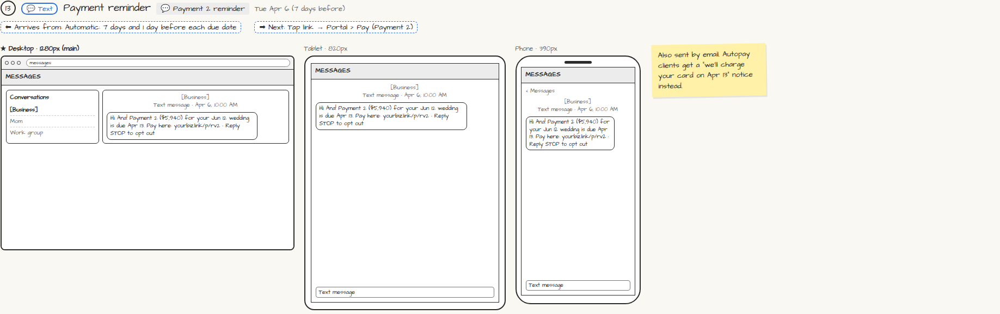

# 💬 Payment reminder

> Generated from `app_outline/user_stories.md` by `pages/build_pages.py`. **Edit stories there**, then re-run the script; edits made here get overwritten.

**Role:** Messages (email / text / push) · **Phase:** P1 · **Stories:** CL-4.1
**Route:** `💬 Payment 2 reminder` · **Wireframe snapshot:** Tue Apr 6 (7 days before)

## Wireframe

Desktop, tablet and phone views plus design notes, cropped from `wireframes/wireframe.html`.

## How you get here, and where you go next

- ⬅ **Arrives from:** Automatic: 7 days and 1 day before each due date
- ➡ **Next:** Tap link → Portal › Pay (Payment 2)

## User stories

### CL-4.1 · Payment reminders · P1

As a client, I want reminders before each payment so that I'm never late.  
_Screens: 💬 Payment reminder_  
- [ ] Email and text 7 days and 1 day before each due date; the link opens Pay directly
- [ ] Autopay clients get "we'll charge your card on [date]" instead
- [ ] Missed payment: reminders at +1 and +7 days; late fee only if the contract allows

## Design notes

- Also sent by email. Autopay clients get a "we'll charge your card on Apr 13" notice instead.

## Tests

See [`tests/README.md`](tests/README.md): one test per acceptance criterion.
