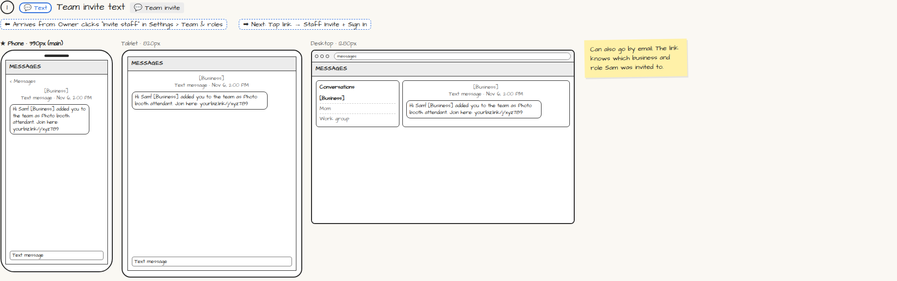

# 💬 Team invite

> Generated from `app_outline/user_stories.md` by `pages/build_pages.py`. **Edit stories there**, then re-run the script; edits made here get overwritten.

**Role:** Messages (email / text / push) · **Phase:** P1 · **Stories:** ST-1.1
**Route:** `💬 Team invite`

## Wireframe

Desktop, tablet and phone views plus design notes, cropped from `wireframes/wireframe.html`.

## How you get here, and where you go next

- ⬅ **Arrives from:** Owner clicks "Invite staff" in Settings › Team & roles
- ➡ **Next:** Tap link → Staff Invite + Sign In

## User stories

### ST-1.1 · Join from an invite · P1

As a staff member, I want to join with my phone number and a code so that I have nothing to remember.  
_Screens: 💬 Team invite, Invite_  
- [ ] Invite text/email links to app download and sign-in
- [ ] Sign in with phone number + SMS code; expired/wrong code → [Send a new code]
- [ ] Linked to the business with the role the owner set
- [ ] Lost phone: the owner can revoke my sessions remotely

## Design notes

- Can also go by email. The link knows which business and role Sam was invited to.

## Related pages

Pages that share a story with this one:

- [Staff Invite + Sign In](../../staff/invite-sign-in/)

## Tests

See [`tests/README.md`](tests/README.md): one test per acceptance criterion.
