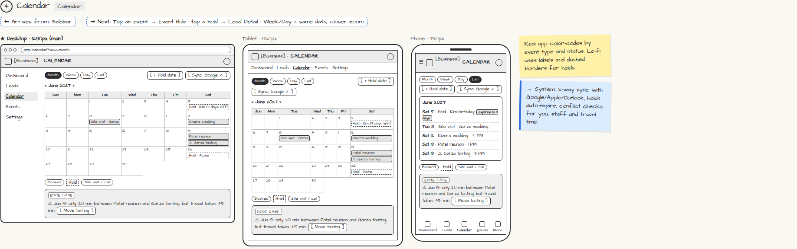

# Calendar

> Generated from `app_outline/user_stories.md` by `pages/build_pages.py`. **Edit stories there**, then re-run the script; edits made here get overwritten.

**Role:** Planner (Owner) · **Phase:** P1 · **Stories:** PL-4.8
**Route:** `Calendar` · **URL:** `app/calendar?view=month`

## Wireframe

Desktop, tablet and phone views plus design notes, cropped from `wireframes/wireframe.html`.

## How you get here, and where you go next

- ⬅ **Arrives from:** Sidebar
- ➡ **Next:** Tap an event → Event Hub · tap a hold → Lead Detail · Week/Day = same data, closer zoom

## User stories

### PL-4.8 · Calendar · P1

As a planner, I want a calendar of everything so that I can plan my weeks.  
_Screens: Calendar_  
- [ ] Month, week, day and list views (list is the phone default); color-coded by event type and status
- [ ] Holds shown dashed with time left; they auto-expire
- [ ] Warnings when I or a staff member is double-booked, or travel time between venues is too short
- [ ] Tap an event → Event Hub; tap a hold → Lead Detail

## → System (backend jobs)

- → System: 2-way sync with Google/Apple/Outlook; holds auto-expire; conflict checks for you, staff and travel time.

## Design notes

- Real app color-codes by event type and status. Lo-fi uses labels and dashed borders for holds.

## Tests

See [`tests/README.md`](tests/README.md): one test per acceptance criterion.
