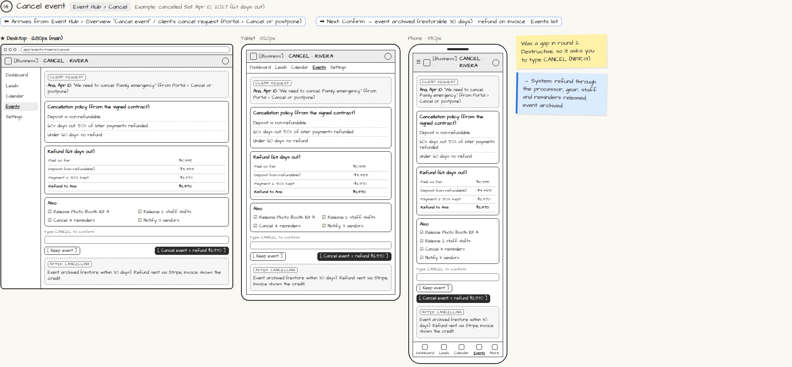

# Cancel event

> Generated from `app_outline/user_stories.md` by `pages/build_pages.py`. **Edit stories there**, then re-run the script; edits made here get overwritten.

**Role:** Planner (Owner) · **Phase:** P1 · **Stories:** PL-3.7
**Route:** `Event Hub › Cancel` · **URL:** `app/events/rivera/cancel` · **Wireframe snapshot:** Example: cancelled Sat Apr 10, 2027 (63 days out)

## Wireframe

Desktop, tablet and phone views plus design notes, cropped from `wireframes/wireframe.html`.

## How you get here, and where you go next

- ⬅ **Arrives from:** Event Hub › Overview "Cancel event" / client's cancel request (Portal › Cancel or postpone)
- ➡ **Next:** Confirm → event archived (restorable 30 days) · refund on Invoice · Events list

## User stories

### PL-3.7 · Cancel an event · P1

As a planner, I want a cancellation flow so that the contract's policy is applied correctly.  
- [ ] Calculates the refund from the contract's cancellation policy and shows it before confirming
- [ ] Releases gear and staff, cancels reminders, archives the event

## → System (backend jobs)

- → System: refund through the processor; gear, staff and reminders released; event archived.

## Design notes

- Was a gap in round 2. Destructive, so it asks you to type CANCEL (NFR-13).

## Tests

See [`tests/README.md`](tests/README.md): one test per acceptance criterion.
