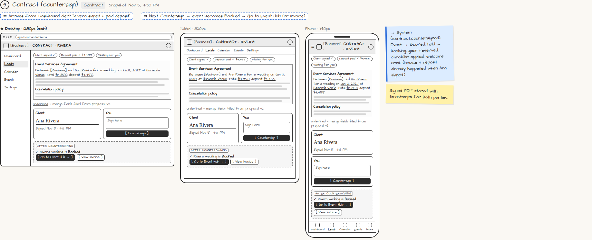

# Contract (countersign)

> Generated from `app_outline/user_stories.md` by `pages/build_pages.py`. **Edit stories there**, then re-run the script; edits made here get overwritten.

**Role:** Planner (Owner) · **Phase:** P1 · **Stories:** PL-3.3, PL-3.4
**Route:** `Contract` · **URL:** `app/contracts/rivera` · **Wireframe snapshot:** Snapshot: Nov 5, 4:30 PM

## Wireframe

Desktop, tablet and phone views plus design notes, cropped from `wireframes/wireframe.html`.

## How you get here, and where you go next

- ⬅ **Arrives from:** Dashboard alert "Rivera signed + paid deposit"
- ➡ **Next:** Countersign → event becomes Booked → Go to Event Hub (or Invoice)

## User stories

### PL-3.3 · Contract generated from my template · P1

As a planner, I want the contract created automatically when the client accepts so that I don't draft it by hand.  
_Events: proposal.accepted_  
- [ ] Generated from my contract template with merge fields filled (names, date, venue, price, deposit, cancellation policy)
- [ ] Merge fields come from the accepted proposal version

### PL-3.4 · Countersign after the client signs and pays · P1

As a planner, I want to countersign once the client has signed and paid the deposit so that the event is officially booked.  
_Screens: Dashboard alert, Contract (countersign) · Events: contract.countersigned_  
- [ ] Dashboard alert "[Client] signed + paid deposit → [Countersign]" appears as soon as both happen
- [ ] Contract shows client signature, timestamp and "Deposit paid ✓"
- [ ] Countersign is refused until the deposit is paid (or waived for a $0 deposit), with a plain-language message
- [ ] Countersigning: event status → Booked, hold → confirmed booking, equipment reserved, checklist applied with due dates relative to the event date
- [ ] Signed PDF is stored with timestamps for both parties
- [ ] After countersigning: [Go to Event Hub] and [View invoice]

## → System (backend jobs)

- → System (contract.countersigned): Event → Booked, hold → booking, gear reserved, checklist applied, welcome email. (Invoice + deposit already happened when Ana signed.)

## Design notes

- Signed PDF stored with timestamps for both parties.

## Tests

See [`tests/README.md`](tests/README.md): one test per acceptance criterion.
