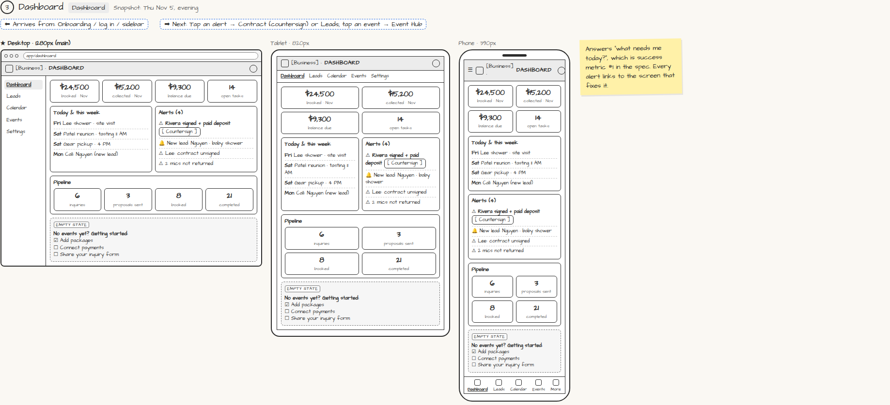

# Dashboard

> Generated from `app_outline/user_stories.md` by `pages/build_pages.py`. **Edit stories there**, then re-run the script; edits made here get overwritten.

**Role:** Planner (Owner) · **Phase:** P1 · **Stories:** PL-1.8
**Route:** `Dashboard` · **URL:** `app/dashboard` · **Wireframe snapshot:** Snapshot: Thu Nov 5, evening

## Wireframe

Desktop, tablet and phone views plus design notes, cropped from `wireframes/wireframe.html`.

## How you get here, and where you go next

- ⬅ **Arrives from:** Onboarding / log in / sidebar
- ➡ **Next:** Tap an alert → Contract (countersign) or Leads; tap an event → Event Hub

## User stories

### PL-1.8 · Getting-started checklist · P1

As a new planner, I want a checklist on my Dashboard so that I know what setup is left.  
_Screens: Dashboard_  
- [ ] Shows until done: add packages, connect payments, share inquiry form
- [ ] Each item links to the screen that completes it

## Design notes

- Answers "what needs me today?", which is success metric #1 in the spec. Every alert links to the screen that fixes it.

## Tests

See [`tests/README.md`](tests/README.md): one test per acceptance criterion.
