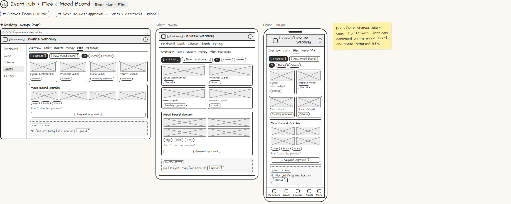

# Event Hub › Files + Mood Board

> Generated from `app_outline/user_stories.md` by `pages/build_pages.py`. **Edit stories there**, then re-run the script; edits made here get overwritten.

**Role:** Planner (Owner) · **Phase:** P1 · **Stories:** PL-4.5
**Route:** `Event Hub › Files` · **URL:** `app/events/rivera/files`

## Wireframe

Desktop, tablet and phone views plus design notes, cropped from `wireframes/wireframe.html`.

## How you get here, and where you go next

- ⬅ **Arrives from:** Hub tab
- ➡ **Next:** Request approval → Portal › Approvals · Upload

## User stories

### PL-4.5 · Files and mood board · P1

As a planner, I want to share files and a mood board with my client so that we agree on the look.  
_Screens: Event Hub › Files_  
- [ ] Upload files; mark each Shared (client sees it) or Private
- [ ] Mood boards with uploads, Pinterest links, color palette and theme notes; client can comment
- [ ] [Request approval] sends the item to Portal › Approvals

## Design notes

- Each file is Shared (client sees it) or Private. Client can comment on the mood board and paste Pinterest links.

## Tests

See [`tests/README.md`](tests/README.md): one test per acceptance criterion.
