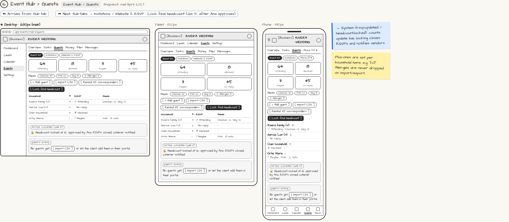

# Event Hub › Guests

> Generated from `app_outline/user_stories.md` by `pages/build_pages.py`. **Edit stories there**, then re-run the script; edits made here get overwritten.

**Role:** Planner (Owner) · **Phase:** P1 · **Stories:** PL-5.1, PL-5.4
**Route:** `Event Hub › Guests` · **URL:** `app/events/rivera/guests` · **Wireframe snapshot:** Snapshot: mid-April 2027

## Wireframe

Desktop, tablet and phone views plus design notes, cropped from `wireframes/wireframe.html`.

## How you get here, and where you go next

- ⬅ **Arrives from:** Hub tab
- ➡ **Next:** Sub-tabs → Invitations / Website & RSVP · Lock final headcount (Jun 5, after Ana approves)

## User stories

### PL-5.1 · Guest list · P1

As a planner, I want a live guest list so that headcount, meals and allergies are always accurate.  
_Screens: Event Hub › Guests › Guest list · Events: rsvp.updated_  
- [ ] Import from CSV/Excel, phone contacts or Google Contacts; the client can add guests too (CL-3.4)
- [ ] Group into households; set plus-ones per household
- [ ] Tags (family, work, VIP, kids…), notes and gift tracking
- [ ] Live counts: attending / declined / maybe / no reply, and meal counts; allergies shown prominently and never dropped on import/export
- [ ] [Remind non-responders] sends a one-tap reminder
- [ ] Imports of 1,000+ rows run in the background with a progress bar (NFR-8)

### PL-5.4 · Lock the final headcount · P1

As a planner, I want to lock the headcount once the client approves it so that vendors get final numbers.  
_Screens: Event Hub › Guests, Portal › Approvals · Events: headcount.locked_  
- [ ] [Lock final headcount] is available once the client approves the final headcount
- [ ] Locking closes RSVPs, finalizes counts, and notifies vendors with a change summary
- [ ] Locked state shows who approved it and when

## → System (backend jobs)

- → System (rsvp.updated / headcount.locked): counts update live; locking closes RSVPs and notifies vendors.

## Design notes

- Plus-ones are set per household here, e.g. "(+1)". Allergies are never dropped on import/export.

## Tests

See [`tests/README.md`](tests/README.md): one test per acceptance criterion.
