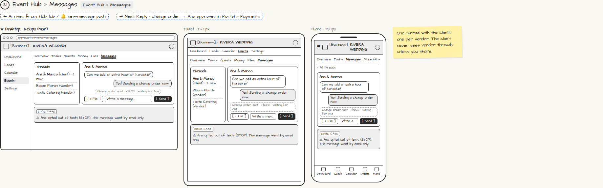

# Event Hub › Messages

> Generated from `app_outline/user_stories.md` by `pages/build_pages.py`. **Edit stories there**, then re-run the script; edits made here get overwritten.

**Role:** Planner (Owner) · **Phase:** P1 · **Stories:** PL-4.6
**Route:** `Event Hub › Messages` · **URL:** `app/events/rivera/messages`

## Wireframe

Desktop, tablet and phone views plus design notes, cropped from `wireframes/wireframe.html`.

## How you get here, and where you go next

- ⬅ **Arrives from:** Hub tab / 🔔 new-message push
- ➡ **Next:** Reply · change order → Ana approves in Portal › Payments

## User stories

### PL-4.6 · Messages · P1

As a planner, I want one thread per event with the client and one per vendor so that conversations stay organized.  
_Screens: Event Hub › Messages_  
- [ ] Client never sees vendor threads unless I share them
- [ ] Attach files; send a change order from the thread
- [ ] If a message bounces or the recipient texted STOP, I see who didn't receive it and by which channel

## Design notes

- One thread with the client, one per vendor. The client never sees vendor threads unless you share.

## Tests

See [`tests/README.md`](tests/README.md): one test per acceptance criterion.
