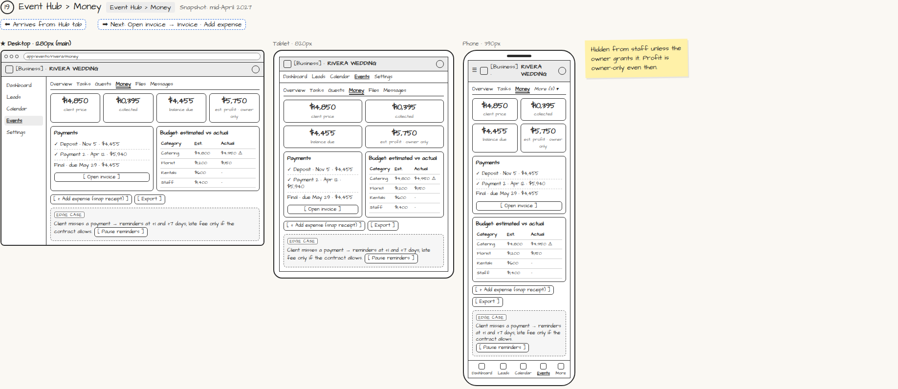

# Event Hub › Money

> Generated from `app_outline/user_stories.md` by `pages/build_pages.py`. **Edit stories there**, then re-run the script; edits made here get overwritten.

**Role:** Planner (Owner) · **Phase:** P1 · **Stories:** PL-4.7
**Route:** `Event Hub › Money` · **URL:** `app/events/rivera/money` · **Wireframe snapshot:** Snapshot: mid-April 2027

## Wireframe

Desktop, tablet and phone views plus design notes, cropped from `wireframes/wireframe.html`.

## How you get here, and where you go next

- ⬅ **Arrives from:** Hub tab
- ➡ **Next:** Open invoice → Invoice · Add expense

## User stories

### PL-4.7 · Money tab · P1

As a planner, I want each event's money in one place so that I know what's collected and what's due.  
_Screens: Event Hub › Money_  
- [ ] Client price, collected, balance due, payment list, [Open invoice]
- [ ] Estimated profit is owner-only
- [ ] Hidden from staff unless granted (PL-1.6)

## Design notes

- Hidden from staff unless the owner grants it. Profit is owner-only even then.

## Tests

See [`tests/README.md`](tests/README.md): one test per acceptance criterion.
