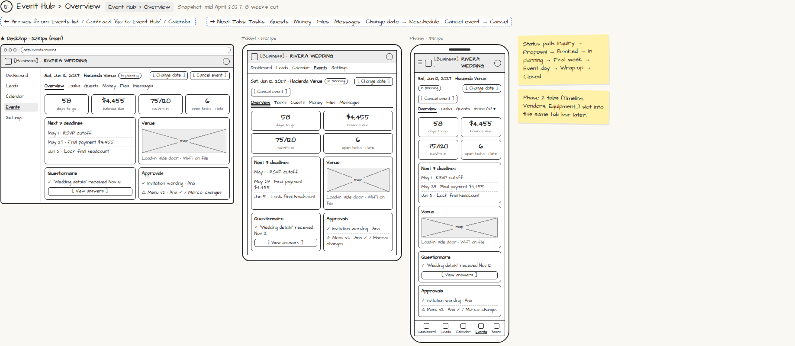

# Event Hub › Overview

> Generated from `app_outline/user_stories.md` by `pages/build_pages.py`. **Edit stories there**, then re-run the script; edits made here get overwritten.

**Role:** Planner (Owner) · **Phase:** P1 · **Stories:** PL-4.2
**Route:** `Event Hub › Overview` · **URL:** `app/events/rivera` · **Wireframe snapshot:** Snapshot: mid-April 2027, 8 weeks out

## Wireframe

Desktop, tablet and phone views plus design notes, cropped from `wireframes/wireframe.html`.

## How you get here, and where you go next

- ⬅ **Arrives from:** Events list / Contract "Go to Event Hub" / Calendar
- ➡ **Next:** Tabs: Tasks · Guests · Money · Files · Messages · Change date → Reschedule · Cancel event → Cancel

## User stories

### PL-4.2 · Event Hub overview · P1

As a planner, I want one overview per event so that I see its health at a glance.  
_Screens: Event Hub › Overview_  
- [ ] Status (Inquiry → Proposal → Booked → In planning → Final week → Event day → Wrap-up → Closed), countdown, balance due, RSVP progress, open/late tasks, next 3 deadlines
- [ ] Questionnaire status and pending approvals with links
- [ ] Venue with map, load-in notes, Wi-Fi
- [ ] Tabs: Overview, Tasks, Guests, Money, Files, Messages (Phase 2+ tabs slot in later)

## Design notes

- Status path: Inquiry → Proposal → Booked → In planning → Final week → Event day → Wrap-up → Closed.
- Phase 2 tabs (Timeline, Vendors, Equipment…) slot into this same tab bar later.

## Tests

See [`tests/README.md`](tests/README.md): one test per acceptance criterion.
