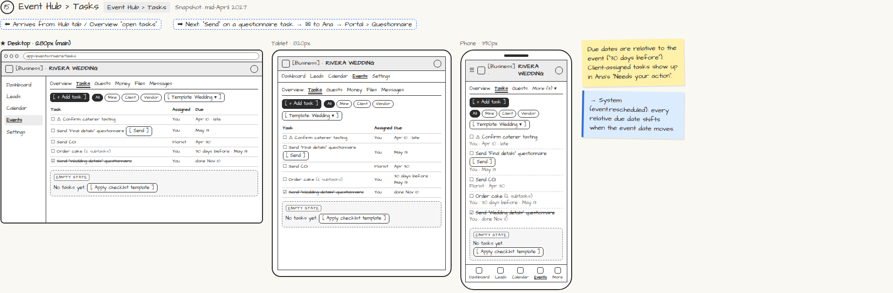

# Event Hub › Tasks

> Generated from `app_outline/user_stories.md` by `pages/build_pages.py`. **Edit stories there**, then re-run the script; edits made here get overwritten.

**Role:** Planner (Owner) · **Phase:** P1 · **Stories:** PL-4.3, PL-4.4
**Route:** `Event Hub › Tasks` · **URL:** `app/events/rivera/tasks` · **Wireframe snapshot:** Snapshot: mid-April 2027

## Wireframe

Desktop, tablet and phone views plus design notes, cropped from `wireframes/wireframe.html`.

## How you get here, and where you go next

- ⬅ **Arrives from:** Hub tab / Overview "open tasks"
- ➡ **Next:** "Send" on a questionnaire task → ✉ to Ana → Portal › Questionnaire

## User stories

### PL-4.3 · Tasks and checklists · P1

As a planner, I want an auto-generated checklist I can assign so that nothing falls through the cracks.  
_Screens: Event Hub › Tasks_  
- [ ] Checklist from the event-type template, with due dates relative to the event ("30 days before")
- [ ] Assign to me, a staff member, the client or a vendor; subtasks; attachments; reorder; add custom tasks
- [ ] Client-assigned tasks appear in the client's "Needs your action"
- [ ] Due-date reminders; late tasks flagged
- [ ] Due dates recalculate if the event date moves (PL-3.6)

### PL-4.4 · Send questionnaires · P1

As a planner, I want to send questionnaires at set points so that client answers fill in the event for me.  
_Screens: Event Hub › Tasks [Send], Portal › Questionnaire (client)_  
- [ ] Send from a task, or automatically at a set point (e.g. "Wedding details" 90 days out)
- [ ] Client answers populate event fields; the task is marked done; Overview shows "received"

## → System (backend jobs)

- → System (event.rescheduled): every relative due date shifts when the event date moves.

## Design notes

- Due dates are relative to the event ("30 days before"). Client-assigned tasks show up in Ana's "Needs your action".

## Tests

See [`tests/README.md`](tests/README.md): one test per acceptance criterion.
