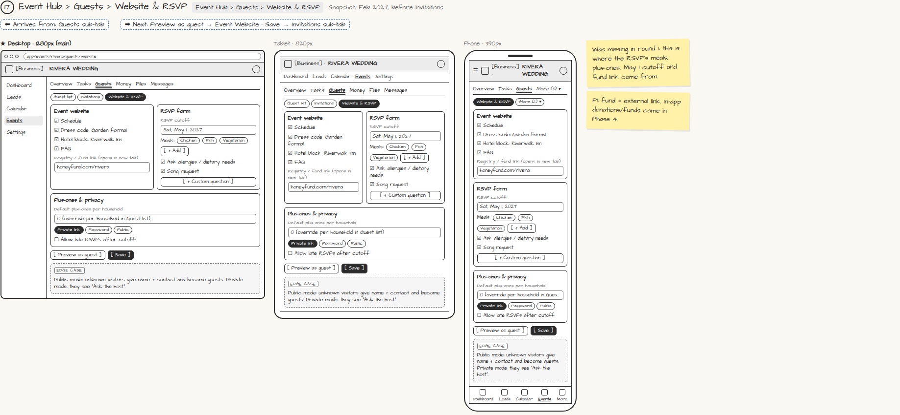

# Event Hub › Guests › Website & RSVP

> Generated from `app_outline/user_stories.md` by `pages/build_pages.py`. **Edit stories there**, then re-run the script; edits made here get overwritten.

**Role:** Planner (Owner) · **Phase:** P1 · **Stories:** PL-5.2
**Route:** `Event Hub › Guests › Website & RSVP` · **URL:** `app/events/rivera/guests/website` · **Wireframe snapshot:** Snapshot: Feb 2027, before invitations

## Wireframe

Desktop, tablet and phone views plus design notes, cropped from `wireframes/wireframe.html`.

## How you get here, and where you go next

- ⬅ **Arrives from:** Guests sub-tab
- ➡ **Next:** Preview as guest → Event Website · Save → Invitations sub-tab

## User stories

### PL-5.2 · Event website and RSVP settings · P1

As a planner, I want to set up the event website and RSVP form so that guests see the right details and questions.  
_Screens: Event Hub › Guests › Website & RSVP_  
- [ ] Toggle sections: schedule, dress code, hotel block, FAQ; add a registry or fund link (opens in a new tab; in-app funds are P4)
- [ ] RSVP cutoff date; meal options; allergies/dietary question; song request; custom questions
- [ ] Default plus-ones per household (override per household in the Guest list)
- [ ] Privacy: private link, password, or public
- [ ] Option to allow late RSVPs after the cutoff
- [ ] [Preview as guest] opens the Event Website

## Design notes

- Was missing in round 1: this is where the RSVP's meals, plus-ones, May 1 cutoff and fund link come from.
- P1: fund = external link. In-app donations/funds come in Phase 4.

## Tests

See [`tests/README.md`](tests/README.md): one test per acceptance criterion.
