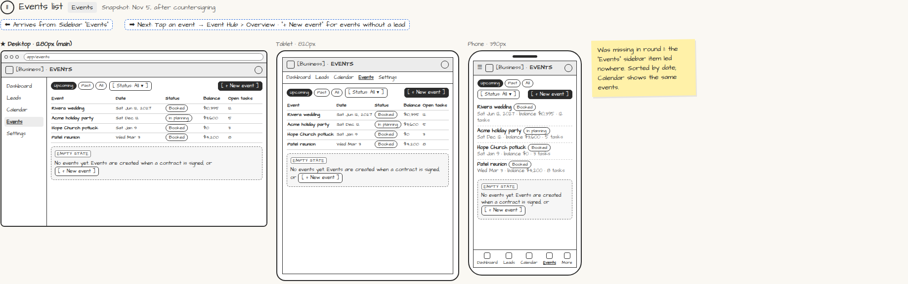

# Events list

> Generated from `app_outline/user_stories.md` by `pages/build_pages.py`. **Edit stories there**, then re-run the script; edits made here get overwritten.

**Role:** Planner (Owner) · **Phase:** P1 · **Stories:** PL-4.1
**Route:** `Events` · **URL:** `app/events` · **Wireframe snapshot:** Snapshot: Nov 5, after countersigning

## Wireframe

Desktop, tablet and phone views plus design notes, cropped from `wireframes/wireframe.html`.

## How you get here, and where you go next

- ⬅ **Arrives from:** Sidebar "Events"
- ➡ **Next:** Tap an event → Event Hub › Overview · "+ New event" for events without a lead

## User stories

### PL-4.1 · Events list · P1

As a planner, I want a list of all my events so that I can open any Event Hub quickly.  
_Screens: Events_  
- [ ] Filters: Upcoming / Past / All, and by status
- [ ] Columns: event, date, status, balance due, open tasks; phone shows cards
- [ ] Tap → Event Hub › Overview
- [ ] [+ New event] for events that didn't come from a lead
- [ ] Empty state explains events are created when a contract is signed

## Design notes

- Was missing in round 1: the "Events" sidebar item led nowhere. Sorted by date; Calendar shows the same events.

## Tests

See [`tests/README.md`](tests/README.md): one test per acceptance criterion.
