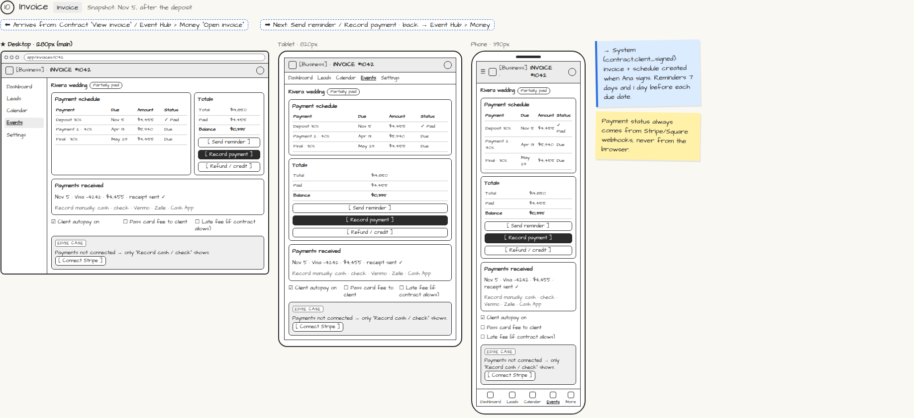

# Invoice

> Generated from `app_outline/user_stories.md` by `pages/build_pages.py`. **Edit stories there**, then re-run the script; edits made here get overwritten.

**Role:** Planner (Owner) · **Phase:** P1 · **Stories:** PL-3.5
**Route:** `Invoice` · **URL:** `app/invoices/1042` · **Wireframe snapshot:** Snapshot: Nov 5, after the deposit

## Wireframe

Desktop, tablet and phone views plus design notes, cropped from `wireframes/wireframe.html`.

## How you get here, and where you go next

- ⬅ **Arrives from:** Contract "View invoice" / Event Hub › Money "Open invoice"
- ➡ **Next:** Send reminder / Record payment · back → Event Hub › Money

## User stories

### PL-3.5 · Invoice and payment schedule · P1

As a planner, I want an invoice and payment schedule created from the signed proposal so that I get paid on time without chasing.  
_Screens: Invoice · Events: contract.client_signed, payment.succeeded, payment.failed_  
- [ ] Created when the client signs (so they can pay the deposit right away), with the schedule from my template (e.g. 30% / 40% at 60 days / 30% at 14 days)
- [ ] Payment status comes only from Stripe/Square webhooks, never from the browser
- [ ] [Record payment] for cash, check, Venmo, Zelle, Cash App
- [ ] Refunds, partial refunds and credits
- [ ] Options: pass card fee to client; late fee (only if the contract allows); client autopay
- [ ] Automatic reminders 7 days and 1 day before each due date, and +1 / +7 days after a missed one; I can pause them
- [ ] I'm alerted after 2 failed payment attempts

## → System (backend jobs)

- → System (contract.client_signed): invoice + schedule created when Ana signs. Reminders 7 days and 1 day before each due date.

## Design notes

- Payment status always comes from Stripe/Square webhooks, never from the browser.

## Tests

See [`tests/README.md`](tests/README.md): one test per acceptance criterion.
