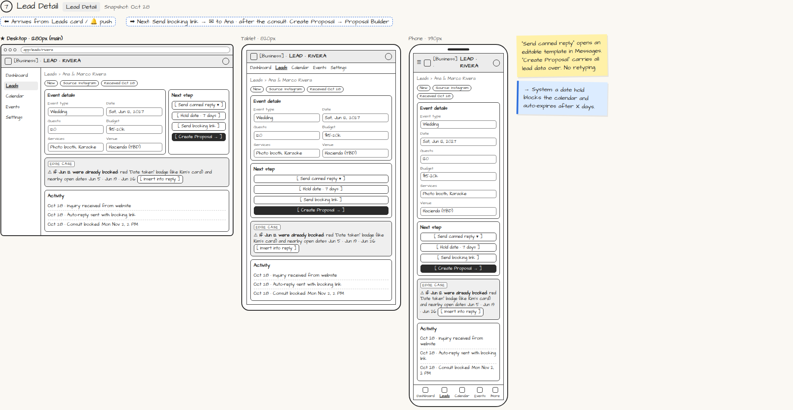

# Lead Detail

> Generated from `app_outline/user_stories.md` by `pages/build_pages.py`. **Edit stories there**, then re-run the script; edits made here get overwritten.

**Role:** Planner (Owner) · **Phase:** P1 · **Stories:** PL-2.3, PL-2.5
**Route:** `Lead Detail` · **URL:** `app/leads/rivera` · **Wireframe snapshot:** Snapshot: Oct 28

## Wireframe

Desktop, tablet and phone views plus design notes, cropped from `wireframes/wireframe.html`.

## How you get here, and where you go next

- ⬅ **Arrives from:** Leads card / 🔔 push
- ➡ **Next:** Send booking link → ✉ to Ana · after the consult: Create Proposal → Proposal Builder

## User stories

### PL-2.3 · Respond to a lead · P1

As a planner, I want to reply, hold the date, or send my booking link from the lead so that I respond fast.  
_Screens: Lead Detail, Calendar_  
- [ ] [Send canned reply] opens an editable template before sending
- [ ] [Hold date] soft-holds the date for X days (shown dashed on the Calendar) and auto-expires
- [ ] [Send booking link] emails the public booking page link
- [ ] If the date is taken: suggested reply offers nearby open dates I can insert
- [ ] Two leads want the same date: the first signed contract wins; the other hold expires and I'm prompted to notify that lead
- [ ] Activity log shows every message, hold and booking

### PL-2.5 · Create a proposal from the lead · P1

As a planner, I want [Create Proposal] to carry over the lead's details so that I never retype.  
_Screens: Lead Detail → Proposal Builder_  
- [ ] Client name, contact, event type, date, guest count and requested services are prefilled

## → System (backend jobs)

- → System: a date hold blocks the calendar and auto-expires after X days.

## Design notes

- "Send canned reply" opens an editable template in Messages. "Create Proposal" carries all lead data over. No retyping.

## Tests

See [`tests/README.md`](tests/README.md): one test per acceptance criterion.
