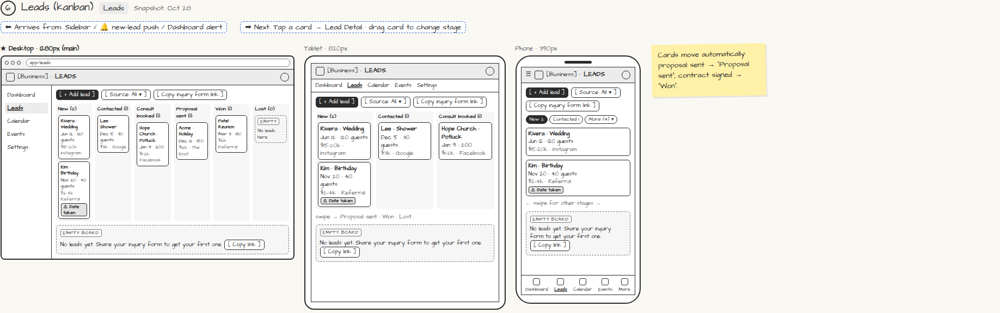

# Leads (kanban)

> Generated from `app_outline/user_stories.md` by `pages/build_pages.py`. **Edit stories there**, then re-run the script; edits made here get overwritten.

**Role:** Planner (Owner) · **Phase:** P1 · **Stories:** PL-2.2
**Route:** `Leads` · **URL:** `app/leads` · **Wireframe snapshot:** Snapshot: Oct 28

## Wireframe

Desktop, tablet and phone views plus design notes, cropped from `wireframes/wireframe.html`.

## How you get here, and where you go next

- ⬅ **Arrives from:** Sidebar / 🔔 new-lead push / Dashboard alert
- ➡ **Next:** Tap a card → Lead Detail · drag card to change stage

## User stories

### PL-2.2 · Leads board · P1

As a planner, I want my leads on a kanban board so that I can see where every prospect stands.  
_Screens: Leads_  
- [ ] Columns: New, Contacted, Consult booked, Proposal sent, Won, Lost
- [ ] Card shows date, event type, guest count, budget and source
- [ ] A red "Date taken" badge shows if the requested date is already booked
- [ ] Drag cards between columns; cards also move automatically (proposal sent → Proposal sent; contract signed → Won)
- [ ] Filter by source (referral, Instagram, Google, The Knot…)
- [ ] Empty board says "Share your inquiry form" with [Copy link]
- [ ] Phone shows one column at a time with stage tabs

## Design notes

- Cards move automatically: proposal sent → "Proposal sent"; contract signed → "Won".

## Tests

See [`tests/README.md`](tests/README.md): one test per acceptance criterion.
