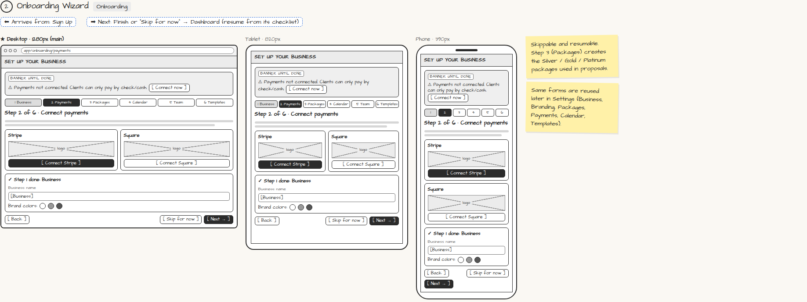

# Onboarding Wizard

> Generated from `app_outline/user_stories.md` by `pages/build_pages.py`. **Edit stories there**, then re-run the script; edits made here get overwritten.

**Role:** Planner (Owner) · **Phase:** P1 · **Stories:** PL-1.2, PL-1.3, PL-1.4, PL-1.5, PL-1.7
**Route:** `Onboarding` · **URL:** `app/onboarding/payments`

## Wireframe

Desktop, tablet and phone views plus design notes, cropped from `wireframes/wireframe.html`.

## How you get here, and where you go next

- ⬅ **Arrives from:** Sign Up
- ➡ **Next:** Finish or "Skip for now" → Dashboard (resume from its checklist)

## User stories

### PL-1.2 · Business profile and branding · P1

As a planner, I want to enter my business name, logo, brand colors and (optionally) a custom domain so that everything clients and guests see carries my brand.  
_Screens: Onboarding Wizard step 1, Settings › Business / Branding_  
- [ ] Name, logo upload, brand colors, optional custom domain (e.g. events.mybusiness.com)
- [ ] Branding appears on all client, guest, vendor and donor pages
- [ ] The wizard is skippable and resumable; progress saves after each step

### PL-1.3 · Connect payments · P1

As a planner, I want to connect Stripe or Square so that clients can pay me online.  
_Screens: Onboarding Wizard step 2, Settings › Payments_  
- [ ] Connect via Stripe or Square OAuth; card numbers never touch our servers
- [ ] Until connected, the Dashboard shows a "Payments not connected" banner with [Connect now]
- [ ] Proposals can still be sent without payments; the deposit step offers "pay by check/cash" only

### PL-1.4 · Service packages and add-ons · P1

As a planner, I want to set up my packages and add-ons with prices and photos so that I can build proposals in minutes.  
_Screens: Onboarding Wizard step 3, Settings › Packages_  
- [ ] Create, edit and archive packages (e.g. Silver / Gold / Platinum) with price, description and photos
- [ ] Create add-ons with unit price and quantity (photo booth hours, chairs…)
- [ ] Add-ons can be linked to equipment so availability can be checked (see PL-3.1)

### PL-1.5 · Connect my calendar · P1

As a planner, I want two-way sync with Google, Apple/iCloud or Outlook so that I never double-book myself.  
_Screens: Onboarding Wizard step 4, Settings › Calendar sync_  
- [ ] Events, holds and consults appear in my external calendar
- [ ] Busy times from my external calendar block my public booking page

### PL-1.7 · Starter templates · P1

As a planner, I want starter checklists, contract and invoice-schedule templates per event type so that new events set themselves up.  
_Screens: Onboarding Wizard step 6, Settings › Templates_  
- [ ] Pick starter templates per event type (wedding, birthday, shower, corporate, fundraiser…)
- [ ] Edit templates later; changes apply to new events only
- [ ] Message templates (auto-reply, canned replies, reminders) are editable here too

## Design notes

- Skippable and resumable. Step 3 (Packages) creates the Silver / Gold / Platinum packages used in proposals.
- Same forms are reused later in Settings (Business, Branding, Packages, Payments, Calendar, Templates).

## Tests

See [`tests/README.md`](tests/README.md): one test per acceptance criterion.
