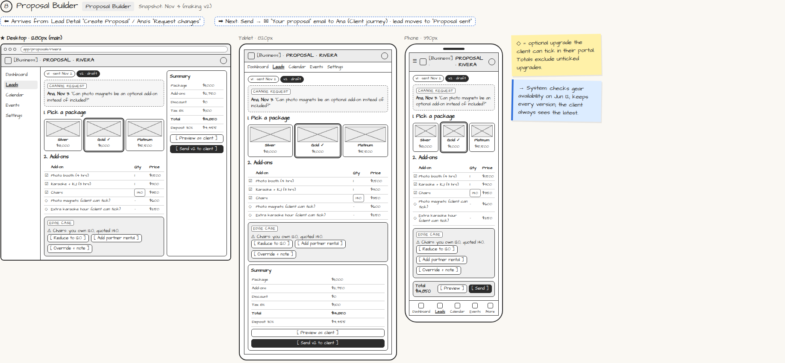

# Proposal Builder

> Generated from `app_outline/user_stories.md` by `pages/build_pages.py`. **Edit stories there**, then re-run the script; edits made here get overwritten.

**Role:** Planner (Owner) · **Phase:** P1 · **Stories:** PL-3.1, PL-3.2
**Route:** `Proposal Builder` · **URL:** `app/proposals/rivera` · **Wireframe snapshot:** Snapshot: Nov 4 (making v2)

## Wireframe

Desktop, tablet and phone views plus design notes, cropped from `wireframes/wireframe.html`.

## How you get here, and where you go next

- ⬅ **Arrives from:** Lead Detail "Create Proposal" / Ana's "Request changes"
- ➡ **Next:** Send → ✉ "Your proposal" email to Ana (Client journey) · lead moves to "Proposal sent"

## User stories

### PL-3.1 · Build a proposal · P1

As a planner, I want to build a proposal from my packages and add-ons so that a quote takes minutes.  
_Screens: Proposal Builder · Events: equipment availability check_  
- [ ] Pick a package; toggle add-ons and set quantities; apply discounts; tax calculated by location
- [ ] Mark add-ons as "optional upgrade" so the client can tick them in the portal
- [ ] Live total and deposit amount update as I edit
- [ ] Each add-on is checked against equipment availability on the event date
- [ ] If I quote more than I own (e.g. 140 chairs, own 120): warning on that line with [Reduce] [Add partner rental] [Override + note]

### PL-3.2 · Send a proposal and handle changes · P1

As a planner, I want to preview, send and revise proposals so that the client always sees the right version.  
_Screens: Proposal Builder, ✉ Proposal email (client) · Events: proposal sent, proposal opened_  
- [ ] [Preview as client] shows exactly what the client will see
- [ ] [Send] emails a magic link; lead moves to "Proposal sent"; I can see when it was opened
- [ ] Client change requests appear on the proposal with their comment
- [ ] Each send creates a new version (v1, v2…); old versions are kept; the client always sees the latest

## → System (backend jobs)

- → System: checks gear availability on Jun 12; keeps every version; the client always sees the latest.

## Design notes

- ◇ = optional upgrade the client can tick in their portal. Totals exclude unticked upgrades.

## Related pages

Pages that share a story with this one:

- [✉ Your proposal (magic link)](../../messages/email-proposal/)

## Tests

See [`tests/README.md`](tests/README.md): one test per acceptance criterion.
