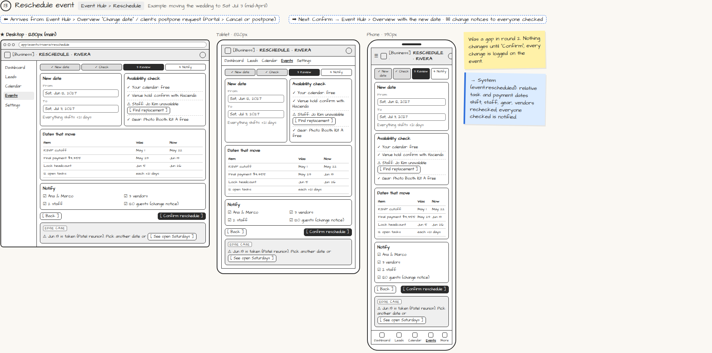

# Reschedule event

> Generated from `app_outline/user_stories.md` by `pages/build_pages.py`. **Edit stories there**, then re-run the script; edits made here get overwritten.

**Role:** Planner (Owner) · **Phase:** P1 · **Stories:** PL-3.6
**Route:** `Event Hub › Reschedule` · **URL:** `app/events/rivera/reschedule` · **Wireframe snapshot:** Example: moving the wedding to Sat Jul 3 (mid-April)

## Wireframe

Desktop, tablet and phone views plus design notes, cropped from `wireframes/wireframe.html`.

## How you get here, and where you go next

- ⬅ **Arrives from:** Event Hub › Overview "Change date" / client's postpone request (Portal › Cancel or postpone)
- ➡ **Next:** Confirm → Event Hub › Overview with the new date · ✉ change notices to everyone checked

## User stories

### PL-3.6 · Reschedule an event · P1

As a planner, I want a reschedule wizard so that moving a date doesn't break anything.  
_Events: event.rescheduled_  
- [ ] Checks my calendar, staff and gear for the new date before confirming
- [ ] Shifts every relative task due date and payment date
- [ ] Notifies everyone affected; logs the change on the event

## → System (backend jobs)

- → System (event.rescheduled): relative task and payment dates shift; staff, gear, vendors rechecked; everyone checked is notified.

## Design notes

- Was a gap in round 2. Nothing changes until "Confirm"; every change is logged on the event.

## Tests

See [`tests/README.md`](tests/README.md): one test per acceptance criterion.
