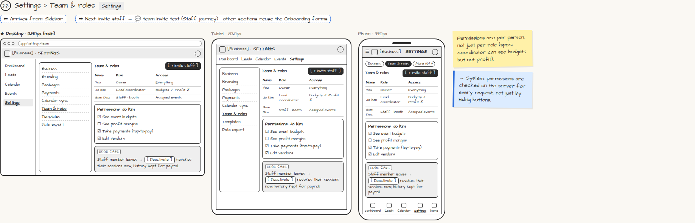

# Settings › Team & roles

> Generated from `app_outline/user_stories.md` by `pages/build_pages.py`. **Edit stories there**, then re-run the script; edits made here get overwritten.

**Role:** Planner (Owner) · **Phase:** P1 · **Stories:** PL-1.6
**Route:** `Settings` · **URL:** `app/settings/team`

## Wireframe

Desktop, tablet and phone views plus design notes, cropped from `wireframes/wireframe.html`.

## How you get here, and where you go next

- ⬅ **Arrives from:** Sidebar
- ➡ **Next:** Invite staff → 💬 team invite text (Staff journey) · other sections reuse the Onboarding forms

## User stories

### PL-1.6 · Invite staff and set permissions · P1

As a planner, I want to invite staff and choose exactly what each person can see so that my team gets access without seeing what they shouldn't.  
_Screens: Settings › Team & roles · Events: staff invite text_  
- [ ] Invite by email or phone; the invite sets a role (coordinator, KJ, booth attendant, server, bartender)
- [ ] Per-person toggles: see event budgets, see profit margins, take payments, edit vendors
- [ ] Staff never see financials unless granted; profit is owner-only
- [ ] [Deactivate] revokes the person's sessions immediately and keeps their history for payroll

## → System (backend jobs)

- → System: permissions are checked on the server for every request, not just by hiding buttons.

## Design notes

- Permissions are per person, not just per role (spec: coordinator can see budgets but not profit).

## Tests

See [`tests/README.md`](tests/README.md): one test per acceptance criterion.
