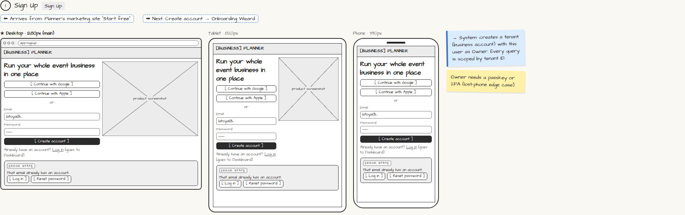

# Sign Up

> Generated from `app_outline/user_stories.md` by `pages/build_pages.py`. **Edit stories there**, then re-run the script; edits made here get overwritten.

**Role:** Planner (Owner) · **Phase:** P1 · **Stories:** PL-1.1
**Route:** `Sign Up` · **URL:** `app/signup`

## Wireframe

Desktop, tablet and phone views plus design notes, cropped from `wireframes/wireframe.html`.

## How you get here, and where you go next

- ⬅ **Arrives from:** Planner's marketing site "Start free"
- ➡ **Next:** Create account → Onboarding Wizard

## User stories

### PL-1.1 · Sign up and create my business account · P1

As a planner, I want to sign up with email, Google or Apple so that my business has its own account in the app.  
_Screens: Sign Up · Events: tenant created_  
- [ ] Sign up works with email + password, Google, or Apple
- [ ] Creates a new tenant (business account) with me as Owner
- [ ] An email that already has an account shows "Log in" and "Reset password" instead of an error dead end
- [ ] Owner must set up a passkey or 2FA before seeing money or settings
- [ ] Lands on the Onboarding Wizard

## → System (backend jobs)

- → System: creates a tenant (business account) with this user as Owner. Every query is scoped by tenant ID.

## Design notes

- Owner needs a passkey or 2FA (lost-phone edge case).

## Tests

See [`tests/README.md`](tests/README.md): one test per acceptance criterion.
