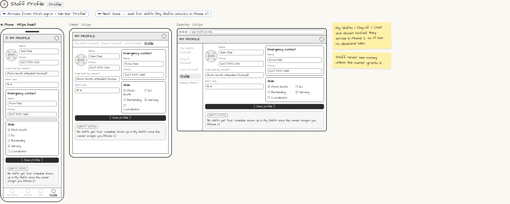

# Staff Profile

> Generated from `app_outline/user_stories.md` by `pages/build_pages.py`. **Edit stories there**, then re-run the script; edits made here get overwritten.

**Role:** Staff · **Phase:** P1 · **Stories:** ST-1.2
**Route:** `Profile` · **URL:** `app/staff/profile`

## Wireframe

Desktop, tablet and phone views plus design notes, cropped from `wireframes/wireframe.html`.

## How you get here, and where you go next

- ⬅ **Arrives from:** First sign-in / tab bar "Profile"
- ➡ **Next:** Save → wait for shifts (My Shifts unlocks in Phase 2)

## User stories

### ST-1.2 · My profile · P1

As a staff member, I want to fill in my profile so that I get the right shifts.  
_Screens: Profile_  
- [ ] Photo, name, phone, emergency contact, skills (KJ, booth, bartending, serving, coordinator), shirt size
- [ ] Role is set by the owner (read-only)
- [ ] Phase 2 tabs (My Shifts, Day-of, Chat) show as locked "Coming in Phase 2"

## Design notes

- My Shifts / Day-of / Chat are shown locked: they arrive in Phase 2, so P1 has no dead-end tabs.
- Staff never see money unless the owner grants it.

## Tests

See [`tests/README.md`](tests/README.md): one test per acceptance criterion.
