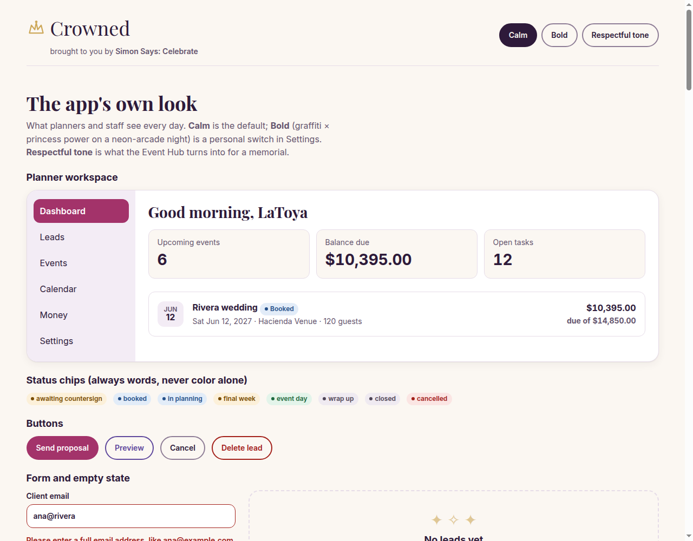
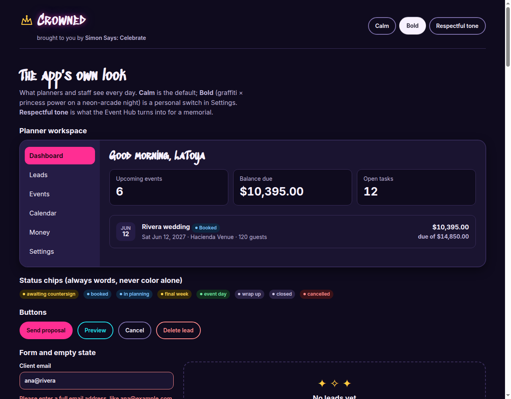
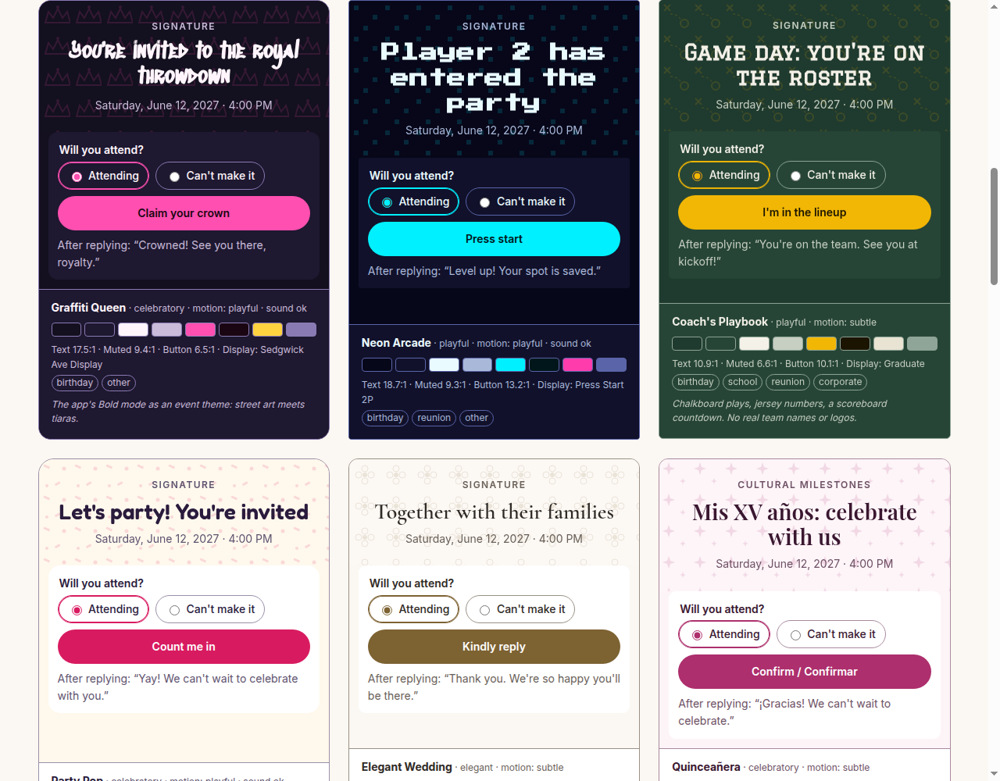
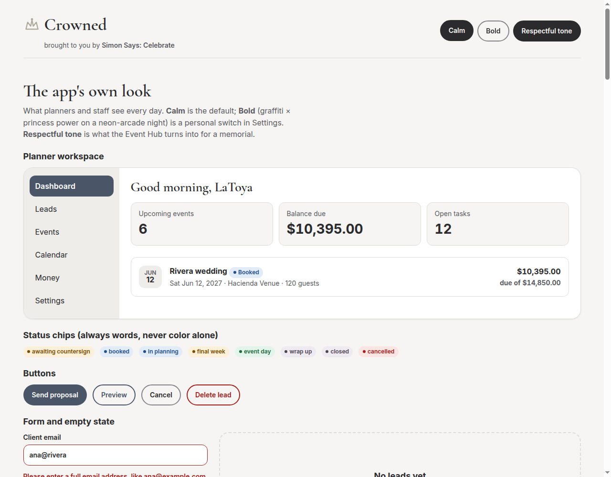

# Style Guide: Crowned

*Brought to you by Simon Says: Celebrate*

The look and feel of the event planner app. **The real values live in code**, and this guide explains how to use them:

| What | Where |
|---|---|
| App colors, spacing, type scale, Calm / Bold / Respectful | [`src/styles/tokens.css`](../src/styles/tokens.css) |
| The 27 event themes (data) | [`src/styles/themes.js`](../src/styles/themes.js) |
| Fonts (self-hosted, with licences) | [`src/assets/fonts/`](../src/assets/fonts/), declared in [`src/styles/fonts.css`](../src/styles/fonts.css) |
| Live preview of everything | [`style_guide/theme_gallery.html`](style_guide/theme_gallery.html) (serve the repo root: `python3 -m http.server 8767`) |
| Contrast check (runs in CI) | `npm run check:contrast` → [`scripts/check_contrast.mjs`](../scripts/check_contrast.mjs) |

Format modelled on [`style_guide_example.md`](style_guide_example.md).



---

## 1. Visual identity

- **Vibe:** *Graffiti × princess power on a neon-arcade night*, with a calm side.
  - **Bold:** spray-paint headings, crowns, sparkle and neon glow, with "queen energy" confidence.
  - **Calm:** the same personality in daylight. Ivory and champagne, deep plum, rose and lavender, an elegant serif and a few gold sparkles: celebratory without shouting.
- **Inspiration:** street-art lettering, tiaras and crowns, arcade cabinets, and the moment a party comes together. **No copying:** no real brands, characters, team logos, award statues or game sprites. All motifs are original, simple shapes.
- **Primary goal:** the planner runs a business all day in this app, so **clarity first and personality second**.
  - Personality shows in headings, the wordmark, empty states, celebrations ("Deposit paid! 👑") and the event themes.
  - It never shows in tables, money, forms or error messages.
- **Three audiences, three jobs:**
  - **Planners and staff:** a fast, readable workspace, often on a phone on event day.
  - **Clients:** a polished portal that feels like their event.
  - **Guests:** a beautiful event page and an RSVP in under a minute, with no account.

### Name and wordmark
The app is **Crowned**, brought to you by **Simon Says: Celebrate** (the owner's business brand).

```
👑 Crowned                                  ← --font-display at wordmark size; crown in --color-gold
   brought to you by Simon Says: Celebrate  ← Inter, --text-sm (14px), --color-muted; brand name semibold
```

- **The name** uses `--font-display` with a small crown icon in `--color-gold`. In Bold mode it gets the neon `--glow`.
- **The byline** is always smaller than the name and always in the body font (never a display font: those start at 24px). It uses `--color-muted`, which passes 4.5:1 in every mode. On a phone it sits on its own line under the name.
- **Where the full lockup shows:** Crowned's own pages: the landing page, sign-in and sign-up, the sidebar footer in the planner workspace, Settings → About, and the footer of platform emails.
- **Where it doesn't:** client portal and guest pages carry the *planner's* brand (§12), so they get only a small "Powered by Crowned" footer. That also keeps "Celebrate" off memorial and vigil pages.
- **In code:** `APP_NAME`, `BRAND_NAME` and `APP_BYLINE` in `themes.js`. Never type the name by hand.
- Other names considered: Tag & Tiara, Confetti Crown, Party Royale.

## 2. How the look is layered

The page you see is built from up to four layers. Lower layers can't break higher ones.

| Layer | Who sets it | Where it shows | Code |
|---|---|---|---|
| 1. **App mode:** Calm *(default)* or Bold *(opt-in)* | Each person, in Settings › Appearance (remembered) | The planner and staff workspace, the landing page | `<html data-mode="bold">` |
| 2. **Business branding** (NFR-15) | The owner, in Settings › Branding | Every client, guest, vendor and donor page: logo, brand color, custom domain | brand color → `--color-accent` in the portal frame |
| 3. **Event theme** | The planner, per event (saved in `events.theme`) | That event's website, invitation, RSVP page, client-portal content, and later photo booth overlays | `themeToCssVars(theme)` on the page wrapper |
| 4. **Respectful tone** | Automatic: theme tone `respectful` *or* event type `memorial` | Guest pages **and** the planner's Event Hub for that event | `data-tone="respectful"` |

**Rule of thumb:** the planner's logo is always visible to clients and guests ("Planned by Bella Events" in the footer), and the event theme is the star of the page.



## 3. Layout

- **Responsive and phone-first** for anything used at an event (guests, staff, event day). Build for 375px, 768px and 1280px, with no sideways scrolling at 320px.
- **Planner workspace (desktop):** a left sidebar (Dashboard, Leads, Events, Calendar, Money, Settings) and a content area with a page title, then the KPI tiles, then lists and cards. Use the wireframes in `wireframes/wireframe.html` for each screen's structure.
- **Planner on a phone:** a bottom tab bar with 4 items plus **More (n)**. The active item is always visible, the same pattern as the fixed wireframes.
- **Client portal:** the planner's logo and brand color in the frame, the event theme inside it, and tabs along the top that fold into **More (n)** on phones.
- **Guest event website:** single column, with the event theme's motif and display font in the header, then the details, the RSVP card and the footer with the planner's logo. It must load in under 2 seconds on a phone (NFR-9).
- **Spacing:** use the 4px grid (`--space-1` to `--space-8`). Use `--space-5` between sections and `--space-3` inside cards. Never cramped: when in doubt, add space.
- **Tap targets:** at least 44px (`--tap-min`) on anything clickable.

## 4. Colors

All colors are CSS variables. **Components never use raw hex values.** Every pair below passes WCAG AA, and `npm run check:contrast` enforces it in CI.

### Calm (default)
| Purpose | Color | Hex | Token |
|---|---|---|---|
| Page background | Warm ivory | `#FBF7F2` | `--color-bg` |
| Cards, panels, inputs | White | `#FFFFFF` | `--color-surface` |
| Selected rows, sidebar | Lavender mist | `#F3ECF5` | `--color-surface-2` |
| Body text | Deep plum | `#2E1A3A` | `--color-text` |
| Secondary text (dates, metadata) | Plum grey | `#66566F` | `--color-muted` |
| Primary actions, active nav | Rose berry | `#A3336A` | `--color-accent` |
| Text on primary buttons | White | `#FFFFFF` | `--color-on-accent` |
| Secondary buttons, links | Lavender | `#5E479C` | `--color-secondary` |
| Decoration (crowns, sparkle) | Champagne gold | `#C9A04A` | `--color-gold` (never for text) |
| Gold text | Dark gold | `#7A5A12` | `--color-gold-ink` |
| Form field borders | Mauve grey | `#8E7D96` | `--color-input-border` |
| Keyboard focus ring | Lavender | `#5E479C` | `--color-focus` |

### Bold (opt-in)
| Purpose | Color | Hex | Token |
|---|---|---|---|
| Page background | Arcade night | `#0F0B1E` | `--color-bg` |
| Cards, panels | Deep violet | `#1A1430` | `--color-surface` |
| Body text | Soft white | `#F7F1FF` | `--color-text` |
| Secondary text | Lilac grey | `#BDB2D8` | `--color-muted` |
| Primary actions | Neon pink | `#FF2E93` | `--color-accent` |
| Text on primary buttons | Near-black | `#1A0612` | `--color-on-accent` (white fails on neon pink) |
| Secondary buttons, links | Cyan | `#22E4F0` | `--color-secondary` |
| Crown gold | Gold | `#FFC940` | `--color-gold` |
| Neon glow | Pink + purple | `--glow` | Decoration only: wordmark, hover on primary buttons |

Use the accent for **the one most important action on a screen**, the active nav item and selected states. Don't make every button, heading or icon pink.

### Status colors (chips)
Each status chip is **ink text on a tinted background, plus the words**. Color is never the only signal.

| Style | Calm ink / bg | Event statuses | Money statuses |
|---|---|---|---|
| success | `#1F6B41` / `#E3F4EA` | event day | paid |
| warning | `#7A4D00` / `#FCF0D9` | awaiting countersign, final week | |
| danger | `#A3201A` / `#FBE5E3` | cancelled | overdue |
| info | `#24508A` / `#E2ECF8` | booked, in planning | partially paid |
| neutral | `#4E4456` / `#EFEAF1` | wrap up, closed | due, open, waived, void |

The mapping is code: `EVENT_STATUS_STYLE` and `MONEY_STATUS_STYLE` in `themes.js`. Bold mode has its own darker versions in `tokens.css`.

## 5. Typography

- **Body:** **Inter**, everywhere, in every mode and theme. It's readable at small sizes and handles Spanish accents (NFR-10).
- **Display (headings only):**
  - Calm: **Playfair Display**.
  - Bold: **Sedgwick Ave Display**, the graffiti font.
  - Respectful: **Cormorant Garamond**.
  - Each event theme picks its own display font.
- **The display-font rule:** use display fonts **only for headings of 24px or more** (`--text-xl-plus`, WCAG "large text"). Never use them for body text, buttons, form labels, tables or money. Graffiti and pixel fonts are hard to read small.
- **Script accent (Great Vibes):** only for names on wedding-style invitations, at 36px or more.
- **Scale:** `--text-xs` 12 · `sm` 14 · `base` 16 · `lg` 18 · `xl` 22 · `xl-plus` 24 · `2xl` 28 · `3xl` 36 · `4xl` 40–64 (fluid). Everything is in rem, so it follows the user's font-size setting.
- **Numbers:** money and counts use `font-variant-numeric: tabular-nums`, so columns line up. Write money as `$14,850.00`.
- **At most two fonts per page** (display plus Inter), so guest pages stay fast.

## 6. Components

Build these once, as reusable React components, and use them everywhere.

- **Buttons:**
  - **Primary:** accent background, `--color-on-accent` text, pill shape. One per screen section.
  - **Secondary:** transparent, with a `--color-secondary` border and text.
  - **Ghost:** transparent, with an input-border outline, for Cancel.
  - **Danger:** transparent, danger ink and border. It always asks to confirm, and the label says what will happen ("Delete lead", not "OK").
  - **Hover:** a 1px lift (Bold adds the glow).
  - **Busy:** the label changes ("Sending…") and the button is disabled, so it can't be double-tapped (NFR-6).
- **EventCard:** date badge, event name, status chip, date · venue · guests in muted text, and the balance due on the right. The whole card is one link to the Event Hub.
- **KPI tile:** a muted label above a large tabular number. Always show the number, even when it's 0.
- **Status chip:** a dot plus words, using the mapping in §4.
- **Money:** tabular numbers, right-aligned in tables, and always two decimals. Hidden from people without `see_budgets`. **Never** show a placeholder like "$—" to them; remove the column instead.
- **Forms:**
  - Labels sit above fields and are always visible (never placeholder-only).
  - Fields have a 1.5px `--color-input-border` border and are at least 44px tall.
  - Errors appear under the field in danger ink, in plain language, saying how to fix it ("Please enter a full email address, like ana@example.com"), and the field is marked `aria-invalid`.
  - Never lose the user's input.
- **Empty states:** a gold sparkle, a short title, and one sentence on what to do next, with a button if there's an action. In Bold mode they can be playful ("No leads yet. Time to spray the town 💅"). In respectful mode there is no sparkle and the wording is plain.
- **Toasts:** short confirmations ("Proposal sent to Ana"), bottom-center on phones and top-right on desktop. They disappear after 5s, and they're announced to screen readers.
- **Loading:** skeleton cards with the same shape as the content; no spinner over the whole page.
- **Celebrations** (deposit paid, contract countersigned): a small confetti or crown burst at most once, skipped with reduced motion and in respectful mode.
- **Event theme wrapper:** wraps all of an event's guest-facing content and sets `--theme-*` variables from `themeToCssVars(theme)`. Components inside read `var(--theme-accent)` and similar, never the app tokens.

## 7. Navigation

- **Planner desktop:** sidebar with the wordmark at the top, then Dashboard, Leads, Events, Calendar, Money, Messages and Settings, and the byline ("brought to you by Simon Says: Celebrate") in the sidebar footer. The current page uses the accent background and `aria-current="page"`.
- **Planner phone:** a bottom bar with 4 items plus **More (n)**; the active item is moved into view if it would be hidden.
- **Client portal:** a top bar with the planner's logo, then tabs (Overview, Proposal, Payments, Planning, Guests, Mood Board, Messages). Locked tabs (before the deposit) show a lock icon and the words "Unlocks after your deposit". They are never just greyed out.
- **Guest pages:** no app navigation, just the event's sections (Details, Schedule, RSVP, Registry) as in-page links. The footer shows the planner's logo, then a small "Powered by Crowned".
- Keep navigation identical across pages, and keep search one tap away for planners.

## 8. Motion

| Level | Used by | What moves |
|---|---|---|
| **none** | respectful themes, reduced-motion users | nothing (`--motion-*` are 0ms) |
| **subtle** | Calm, elegant themes | hover lifts, fades (120–180ms) |
| **playful** | Bold, playful themes | the above, plus a one-time confetti/crown burst on big moments and a countdown pulse |

- Transitions are short (`--motion-fast` 120ms, `--motion-base` 180ms) and use `--ease`.
- Never auto-play sound. Themes with `sound: true` may offer a tap-to-play chime (photo booth countdown, for example).
- `prefers-reduced-motion` turns every duration to 0. `tokens.css` already does this.

## 9. Voice and microcopy

| Moment | Calm | Bold | Respectful |
|---|---|---|---|
| Dashboard greeting | Good morning, LaToya | Hey queen, let's run it 👑 | Good morning, LaToya |
| Deposit paid | Deposit received from Ana Rivera | Deposit's in! Ana Rivera is locked in 👑 | Payment received from the family |
| Empty leads | No leads yet. Share your inquiry form to get started. | No leads yet. Time to spray the town. | No inquiries yet. |
| Error | We couldn't send the proposal. Check the email address and try again. | *(errors are never jokey: same as Calm)* | *(same as Calm)* |
| Guest RSVP thanks | *(from the event theme's `copy.thanks`)* | | Thank you. Your response has been shared with the family. |

- Plain language, short sentences, active voice. Errors say what happened and what to do next (NFR-12).
- **Errors, money and legal text never use slang or emoji**, even in Bold.
- Guest copy follows the guest's language (English or Spanish, NFR-10). Translate the theme's `copy` strings too.

## 10. Accessibility (WCAG 2.1 AA for every client and guest page)

- **Contrast:** text at least 4.5:1, large text and UI parts (borders, focus rings) at least 3:1. **Enforced by `npm run check:contrast` in CI** for every mode and every theme (315 pairs).
- **Focus:** a visible 3px `--color-focus` outline on every interactive element; never remove it.
- **Color is never the only signal:** status chips have words, errors have text and an icon, and locked tabs say "locked".
- **Decoration is hidden:** motif patterns, sparkles and glow are decorative (`aria-hidden`), and the page must make sense without them.
- **Text alternatives:** `alt` text on meaningful images such as event photos and the planner's logo ("Bella Events logo"); empty `alt=""` on decorative ones.
- **Keyboard:** everything works by keyboard, in a logical order. Dialogs trap focus and close with Esc.
- **Touch:** targets at least 44px; spacing between adjacent buttons.
- **Text size:** rem units throughout; the layout still works at 200% zoom.
- **Respectful pages** are especially for older and grieving guests: large, plain text, and nothing moving.

## 11. Event theme gallery



A planner picks one theme per event (default below). They can then adjust the colors, photos and wording, but **any custom color must pass the same contrast check**; the app suggests the nearest passing shade. All motifs are original shapes (`MOTIFS` in `themes.js`).

| Theme | Group | Tone | Best for | Display font | Background · Accent | Motion |
|---|---|---|---|---|---|---|
| **Graffiti Queen** `graffiti-queen` | Signature | celebratory | birthday, other | Sedgwick Ave Display | `#14101F` · `#FF4FB0` | playful, sound |
| **Neon Arcade** `neon-arcade` | Signature | playful | birthday, reunion, other | Press Start 2P | `#07071A` · `#00F0FF` | playful, sound |
| **Coach's Playbook** `coachs-playbook` | Signature | playful | birthday, school, reunion, corporate | Graduate | `#1F3A2E` · `#F2B705` | subtle |
| **Party Pop** `party-pop` | Signature | celebratory | birthday | Fredoka | `#FFF8EC` · `#D81B60` | playful, sound |
| **Elegant Wedding** `elegant-wedding` | Signature | elegant | wedding, bridal shower | Cormorant Garamond | `#FBF8F3` · `#7D6232` | subtle |
| **Quinceañera** `quinceanera` | Cultural milestones | celebratory | birthday | Playfair Display | `#FDF4F8` · `#AD2F6D` | subtle |
| **Sweet Sixteen** `sweet-sixteen` | Cultural milestones | celebratory | birthday | Fredoka | `#1C1026` · `#FF7AC6` | playful, sound |
| **Fiesta** `fiesta` | Cultural milestones | celebratory | birthday, reunion, holiday, corporate | Fredoka | `#FFF9EF` · `#B83C0B` | playful |
| **Milestone** `milestone` | Cultural milestones | elegant | birthday, church | Playfair Display | `#F5F7FB` · `#1E3A8A` | subtle |
| **Roaring 20s** `roaring-20s` | Retro & glam | elegant | wedding, fundraiser, corporate, birthday | Bebas Neue | `#0E0E0E` · `#D4AF37` | subtle |
| **Red Carpet** `red-carpet` | Retro & glam | elegant | birthday, fundraiser, corporate | Playfair Display | `#120709` · `#E11D48` | subtle |
| **Throwback 80s/90s** `throwback` | Retro & glam | playful | reunion, birthday | Permanent Marker | `#FFF5E1` · `#6A1BE0` | playful, sound |
| **Masquerade** `masquerade` | Retro & glam | elegant | fundraiser, birthday, holiday | Cormorant Garamond | `#140F1F` · `#C9A24A` | subtle |
| **Tropical Luau** `tropical-luau` | Seasonal & outdoor | celebratory | birthday, reunion, corporate | Fredoka | `#F2FBF7` · `#B4372A` | playful |
| **Boho Garden** `boho-garden` | Seasonal & outdoor | elegant | wedding, bridal shower, baby shower | Cormorant Garamond | `#F7F3EC` · `#8B5E3C` | subtle |
| **Winter Wonderland** `winter-wonderland` | Seasonal & outdoor | celebratory | holiday, wedding, corporate | Playfair Display | `#F1F6FB` · `#1D5FA8` | subtle |
| **Fall Harvest** `fall-harvest` | Seasonal & outdoor | celebratory | holiday, potluck, church, wedding | Playfair Display | `#FBF5EC` · `#A4441A` | subtle |
| **Little One** `little-one` | Life & community | celebratory | baby shower | Fredoka | `#F7FAFD` · `#3E6FB0` | subtle |
| **Graduation** `graduation` | Life & community | celebratory | school, birthday | Graduate | `#F7F7F2` · `#1F4E8C` | subtle |
| **Gala Night** `gala-night` | Life & community | elegant | fundraiser, corporate | Playfair Display | `#0D1321` · `#E5C07B` | subtle |
| **Community Potluck** `community-potluck` | Life & community | celebratory | potluck, church, school, reunion | Fredoka | `#FFFBF3` · `#2F6B3B` | subtle |
| **Celebration of Life** `celebration-of-life` | Respectful | respectful | memorial | Cormorant Garamond | `#F6F4EF` · `#5A6B5D` | none |
| **In Loving Memory** `in-loving-memory` | Respectful | respectful | memorial, church | Cormorant Garamond | `#F4F4F2` · `#3F4A5A` | none |
| **Candlelight Vigil** `candlelight-vigil` | Respectful | respectful | memorial, church | Cormorant Garamond | `#121016` · `#E8B864` | none |
| **Online Game Night** `online-game-night` | Virtual | playful | birthday, reunion, corporate, other | Press Start 2P | `#0B1020` · `#7CFF6B` | playful, sound |
| **Watch Party** `watch-party` | Virtual | celebratory | birthday, reunion, other | Bebas Neue | `#0E0B0B` · `#FFB23E` | subtle |
| **Virtual Celebration** `virtual-celebration` | Virtual | celebratory | wedding, birthday, corporate, church, other | Fredoka | `#F5F3FF` · `#5B3FD1` | subtle |

**Default theme for each event type** (`DEFAULT_THEME_FOR_EVENT_TYPE`): `wedding` → elegant-wedding · `birthday` → party-pop · `baby_shower` → little-one · `bridal_shower` → boho-garden · `corporate` → gala-night · `school` → graduation · `church` → community-potluck · `fundraiser` → gala-night · `reunion` → throwback · `holiday` → winter-wonderland · `memorial` → celebration-of-life · `potluck` → community-potluck · `other` → graffiti-queen

**Cultural milestone themes** (Quinceañera, Fiesta, Milestone): design *with* the family. Ask about colors, religious symbols and wording before adding them, offer bilingual copy, and never use costume clichés or stereotypes.

**Virtual themes** (Online Game Night, Watch Party, Virtual Celebration) are ready visually, but the app can't run virtual events yet; see Open questions.

## 12. Business branding (NFR-15)

- The planner's **logo** appears in the header of the client portal and in the footer of every guest page ("Planned by Bella Events").
- The planner's **brand color** replaces `--color-accent` in the client-portal frame. If it fails contrast (4.5:1 for text on it, 3:1 against the background), the app automatically uses the nearest darker or lighter shade that passes, and tells the owner in Settings › Branding.
- Brand colors never override an event theme's colors inside the event page. The theme is the event's look; the brand is the planner's signature.
- A custom domain (`events.mybusiness.com`) changes no styling.

## 13. Respectful events (funerals, memorials, vigils)



When an event's theme tone is `respectful` **or** its type is `memorial` (`isRespectful()` in `themes.js`), these rules apply:

- **Everywhere guests look** (website, invitation, RSVP, reminders) **and in the planner's own Event Hub for that event**:
  - no confetti, sparkle, crowns, neon glow, sound or animation (`--sparkle-opacity: 0`, motion 0ms);
  - muted colors and a calm serif;
  - wording is plain and kind. Not "Woohoo!", "Yay!" or "Party"; use "Thank you. Your response has been shared with the family."
- **Celebration moments are skipped:** no "Deposit's in! 👑" toast; use "Payment received from the family."
- **Reminder emails and texts** use the respectful wording too, and are fewer and gentler by default.
- The rest of the planner's workspace (Dashboard, other events) keeps their chosen Calm or Bold look. Only this event's views go quiet.

## 14. Implementation priorities

Build in this order:
1. **Tokens and fonts:** import `src/styles/tokens.css` in `main.jsx`, remove the Vite starter CSS, and add the `data-mode` setting (default Calm, saved per person).
2. **Core components:** Button, StatusChip, Money, KPI tile, EventCard, form fields, EmptyState and Toast, using only token variables.
3. **App shell:** sidebar plus bottom bar with "More (n)", the wordmark, and the Calm/Bold switch in Settings.
4. **First MVP slice screens:** sign-up, Dashboard, Leads, Proposal builder.
5. **EventTheme wrapper and RSVP page:** `themeToCssVars`, respectful handling, and the theme picker on the Event Hub.
6. **Client portal frame:** business branding, plus the contrast fallback for brand colors.
7. **Polish:** loading skeletons, empty and error states, the celebration moment, and Spanish strings.

**Senior engineer's advice:** make **one** `ThemeProvider` that sets `data-mode` on `<html>`, and one `EventTheme` wrapper that sets `--theme-*` variables and `data-tone`.
- **Components read CSS variables only;** they never import colors or check "is this Bold?" in JavaScript.
- Adding a theme, or changing the brand later, is then a **data change**, not a redesign.
- Every new theme or color goes through `npm run check:contrast` before it can merge.

## 15. Open questions

- **Name check before launch:** *Crowned* and *Simon Says: Celebrate* are both common phrases. Check trademarks (USPTO search), domains and app-store names before going public.
- **Virtual events:** the data model has no "virtual" flag or meeting link (`events` has only venue fields). That needs a user story (for example "As a planner, I want to add a stream or game link so remote guests can join") and a schema change before the virtual themes are fully usable.
- **Spanish copy** for each theme's `copy` strings (NFR-10).
- **Photo booth overlays** (P3) will reuse each theme's colors, display font and motif; their design is still to come.
