# How to use Crowned

> Generated from `src/data/howTo.js` by `npm run docs:howto`. The in-app **Help** page (`/help`) shows the same guide, with a "Show me" button on every step. Edit the words there, then re-run the script.

Crowned runs an event business from the first inquiry to the last thank-you. This guide walks through it the way you’ll use it: as the planner, as a client, as a guest and as a team member.

## About this demo

- Phases 1–4 are all here: booking, then event operations, the guest experience (karaoke, photo booth, invitation designer) and growth (fundraising, tickets, seating, reports). This is a demo with no backend yet. Everything you do lives in your browser and resets when you refresh, so try anything.
- The demo always lives on Thursday, November 5, 2026. Bella Events is the business; LaToya Simon is the owner.
- Use the **Viewing as** menu in the dark bar at the top to switch between the planner (LaToya), a coordinator (Devon), two clients (Ana, before booking; Priya, after), a guest (Dana), a staff member (Sam) and a vendor.
- Every email, text and notification the app "sends" lands in the **Outbox** (top bar). Their buttons open the real screen as the person it was sent to.

## Contents

1. [Set up your business](#setup) · *Planner*
2. [Turn an inquiry into a proposal](#leads) · *Planner*
3. [Book: accept, sign and pay (the client’s side)](#booking) · *Client*
4. [Countersign, invoice and see all events](#countersign) · *Planner*
5. [Plan the event (Event Hub)](#hub) · *Planner*
6. [Plan together (the client’s portal)](#portal) · *Client*
7. [RSVP (the guest’s side)](#guests) · *Guest*
8. [Run your team](#team) · *Planner & staff*
9. [Vendors, gear and the run of show](#logistics) · *Planner*
10. [Schedule staff (and the staff app)](#staff-app) · *Planner & staff*
11. [Run the event day, then wrap up](#event-day) · *Planner*
12. [Potluck and volunteer sign-ups](#potluck) · *Planner & guest*
13. [Karaoke](#karaoke) · *Planner & guest*
14. [Photo booth and galleries](#booth) · *Planner & guest*
15. [Design the invitation](#designer) · *Planner*
16. [Fundraising: donations, auction and sponsors](#fundraising) · *Planner & guest*
17. [Tickets, floor plan and seating](#seating) · *Planner & guest*
18. [Grow the business](#grow) · *Planner*
19. [Tips](#tips)

## Set up your business

*Planner.* About 10 minutes. You can skip any step and come back from the Dashboard checklist.

### 1. Create your account

Sign up with Google, Apple or an email and password, then protect the account with a passkey or an authenticator app. Owners must, because the account holds money.

**Try it:** open `/app/signup`, or use **Show me** on the Help page.

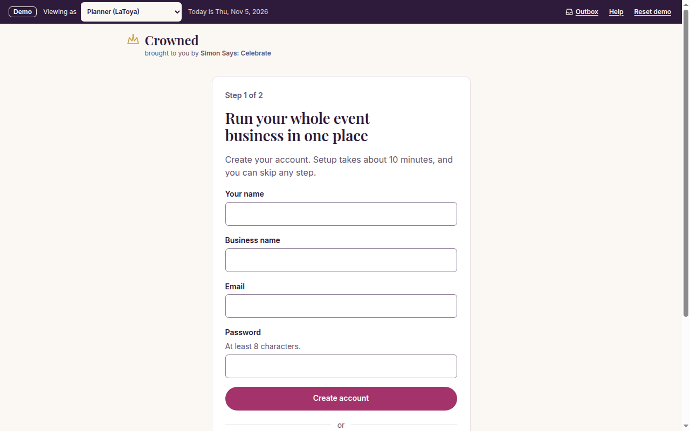

### 2. Walk through the setup steps

Business details and branding (logo and brand color appear on everything clients and guests see), payments (Stripe or Square), packages and add-ons, calendar, team, and message templates.

**Try it:** open `/app/onboarding/business`, or use **Show me** on the Help page.

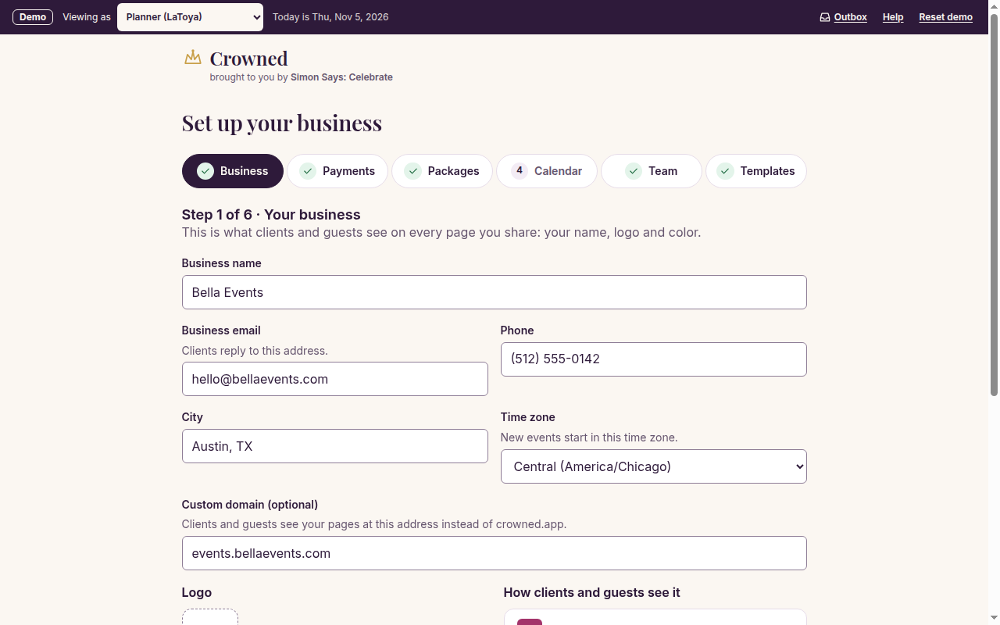

### 3. Share your inquiry form

On the Dashboard, “Copy link” under Getting started copies your public inquiry form. Put it on your website, Instagram and Facebook. Every submission becomes a lead.

**Try it:** open `/app/dashboard`, or use **Show me** on the Help page.

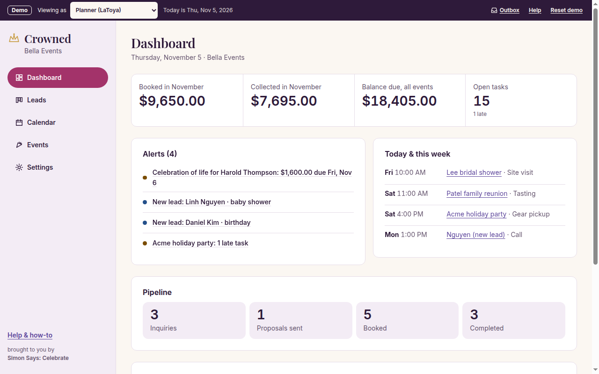

### 4. Change anything later in Settings

Settings uses the same forms as setup: business, branding, packages, payments, calendar, team and roles, templates, export, and Calm or Bold appearance.

**Try it:** open `/app/settings/business`, or use **Show me** on the Help page.

## Turn an inquiry into a proposal

*Planner.* Inquiries arrive on their own; you decide the next step.

### 1. Watch leads arrive

A new inquiry sends you a notification, emails the prospect an auto-reply with your booking link, and lands in the New column of Leads. A red “Date taken” badge means that date is already booked.

**Try it:** open `/app/leads`, or use **Show me** on the Help page.

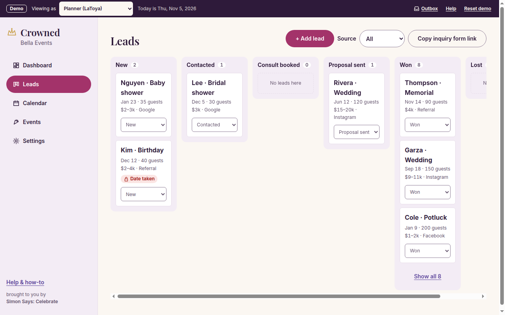

### 2. Move leads along

Drag a card to another column, or use its “Move to” menu (works with a keyboard and on phones). Sending a proposal and signing a contract move cards for you.

**Try it:** open `/app/leads`, or use **Show me** on the Help page.

### 3. Reply, hold the date, or send your booking link

Open a lead. “Send canned reply” opens your template so you can edit it first. “Hold date” blocks the date for 7 days. If the date is taken, Crowned suggests nearby open dates you can drop into the reply.

**Try it:** open `/app/leads/kim`, or use **Show me** on the Help page.

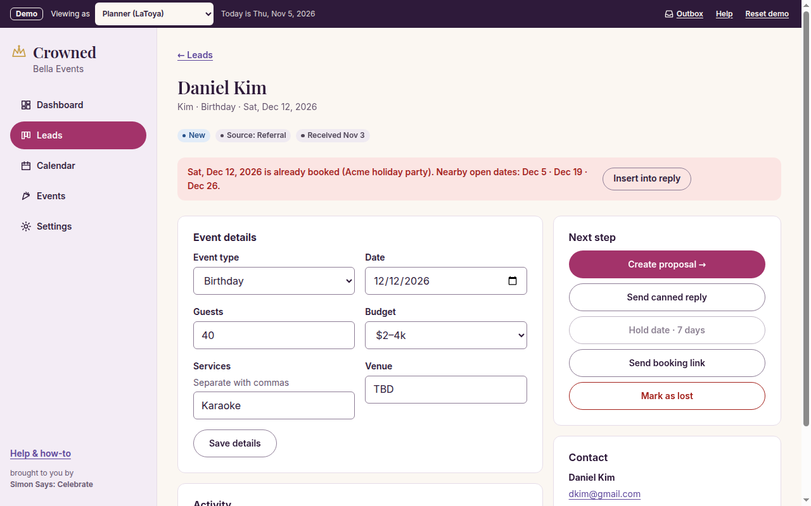

### 4. Let prospects book a consult

Your booking page only shows times you’re free (weekdays, a buffer around your appointments, at most three consults a day). Booking adds it to your calendar and the lead.

**Try it:** open `/b/bella-events/book` (viewing as client), or use **Show me** on the Help page.

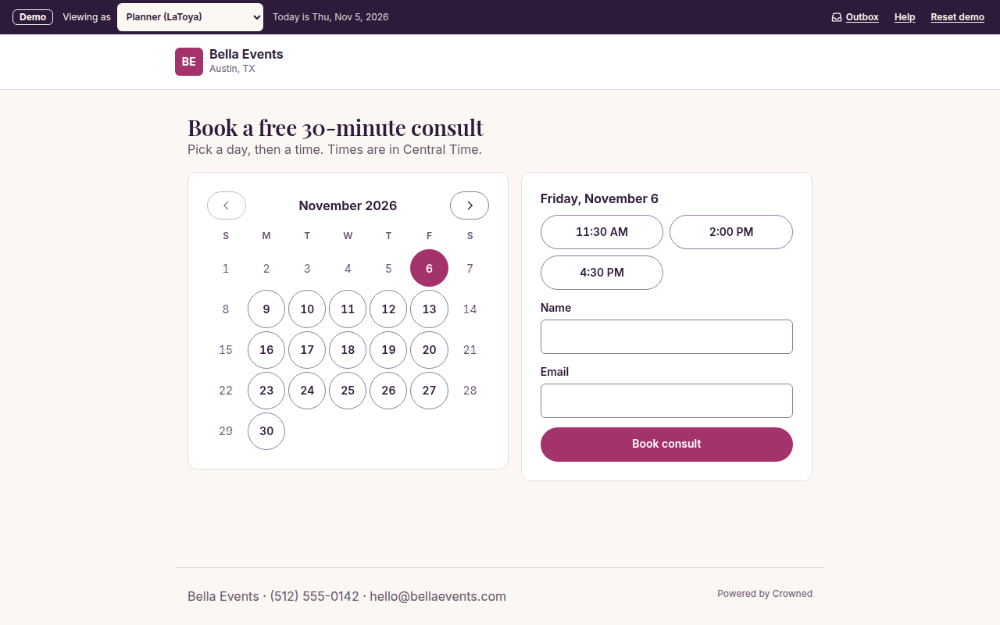

### 5. Build and send the proposal

Pick a package, tick add-ons and set quantities, mark upgrades the client can choose (◇), add a discount. Tax, total and deposit update as you go. If you quote more gear than you own, fix it right on the line. “Preview as client” shows exactly what they’ll see; each send is a new version.

**Try it:** open `/app/proposals/rivera`, or use **Show me** on the Help page.

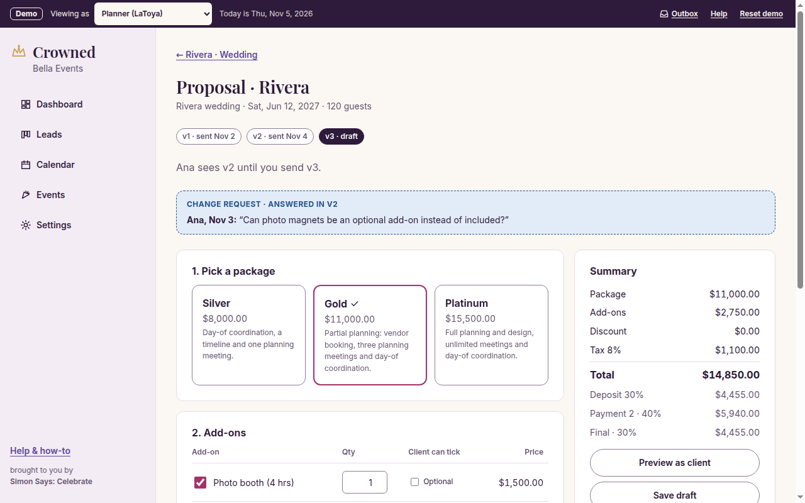

## Book: accept, sign and pay (the client’s side)

*Client.* Clients do it all in one sitting from the proposal email. No password.

### 1. Review and accept

The proposal shows what’s included; ticking an optional upgrade updates the total. Ask a question, request changes, or accept.

**Try it:** open `/portal/proposal` (viewing as ana), or use **Show me** on the Help page.

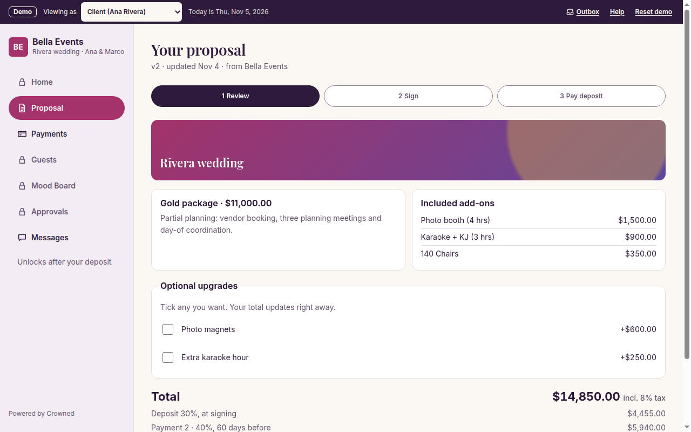

### 2. Sign the contract

Read it (or download it), agree to sign electronically, and type your name or draw a signature.

**Try it:** open `/portal/proposal` (viewing as ana), or use **Show me** on the Help page.

### 3. Pay the deposit

Card, Apple Pay, Google Pay or bank transfer, with optional autopay. In the demo, card 4242 4242 4242 4242 works and 4000 0000 0000 0002 is declined (nothing is charged). Paying the deposit locks the date and opens the rest of the portal.

**Try it:** open `/portal/proposal` (viewing as ana), or use **Show me** on the Help page.

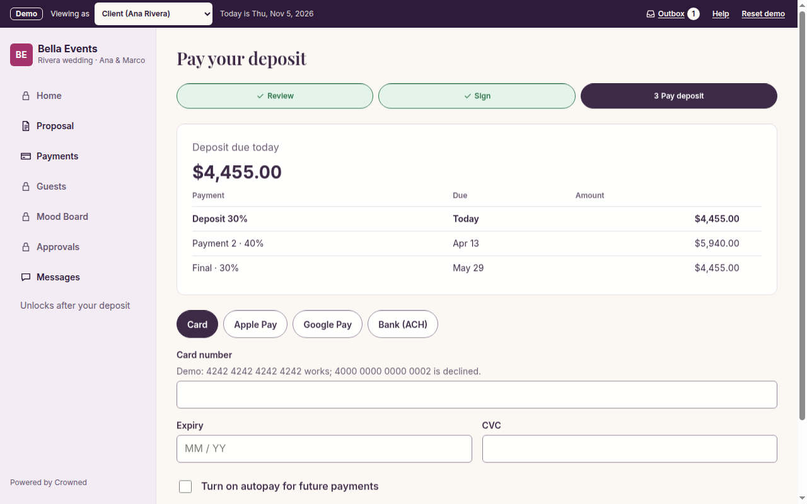

## Countersign, invoice and see all events

*Planner.* Once the client has signed and paid, it’s your turn.

### 1. Countersign from the Dashboard alert

“Signed and paid the deposit → Countersign” appears on your Dashboard. Countersigning books the event and adds the checklist for that event type, with due dates counted back from the event. Crowned won’t let you countersign before the deposit is paid.

**Try it:** open `/app/dashboard`, or use **Show me** on the Help page.

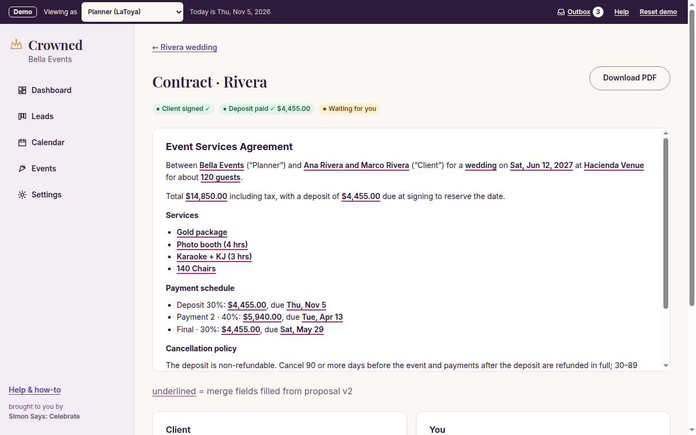

### 2. Manage the invoice

See the payment schedule, record cash, check, Venmo, Zelle or Cash App payments, refund or credit, send a reminder, and choose autopay, card-fee and late-fee options. Card payments are marked paid by Stripe or Square, never by hand.

**Try it:** open `/app/invoices/acme`, or use **Show me** on the Help page.

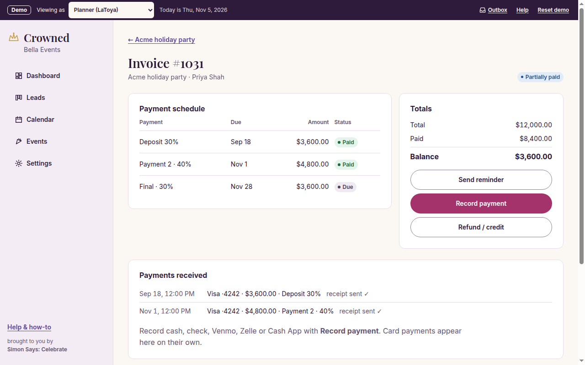

### 3. Find any event

Events lists upcoming, past or all events, with balance and open tasks. “+ New event” is for events that didn’t start as a lead.

**Try it:** open `/app/events`, or use **Show me** on the Help page.

## Plan the event (Event Hub)

*Planner.* Everything about one event, in tabs. The Acme holiday party is the busiest demo event.

### 1. Overview

Countdown, balance, RSVPs, tasks, the next three deadlines, venue details, the questionnaire and approvals, and the event’s history.

**Try it:** open `/app/events/acme`, or use **Show me** on the Help page.

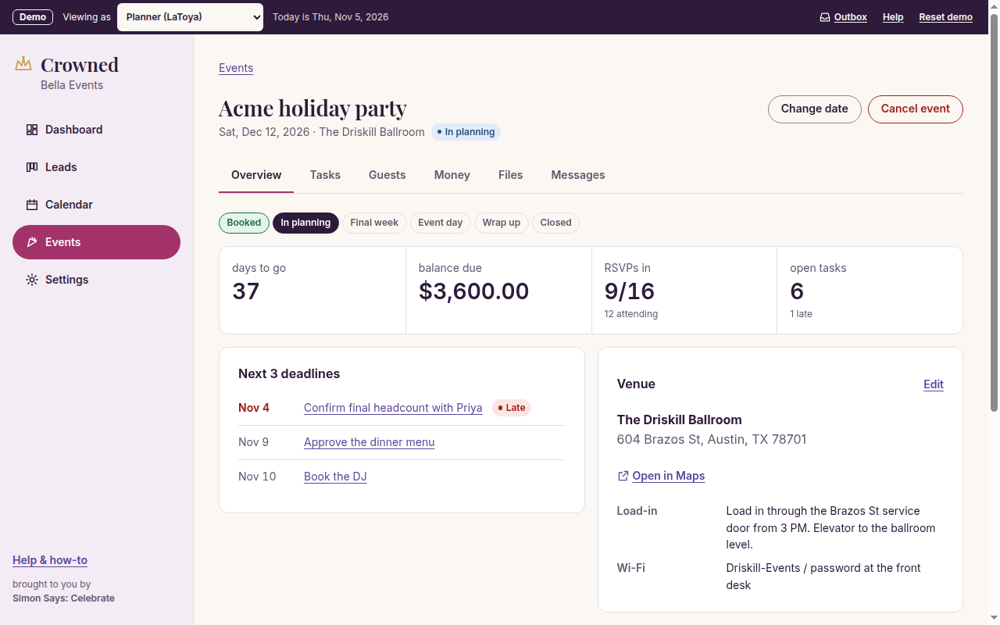

### 2. Tasks and questionnaires

Assign tasks to yourself, a teammate, the client (it shows in their portal) or a vendor. Add subtasks, reorder, and undo a removal. “Send questionnaire” emails the client a form whose answers fill in the event.

**Try it:** open `/app/events/acme/tasks`, or use **Show me** on the Help page.

### 3. Guests

Households with plus-ones, tags and notes; live counts, meals and allergies. Import a spreadsheet (CSV), remind people who haven’t replied, and lock the final headcount once the client approves it.

**Try it:** open `/app/events/acme/guests`, or use **Show me** on the Help page.

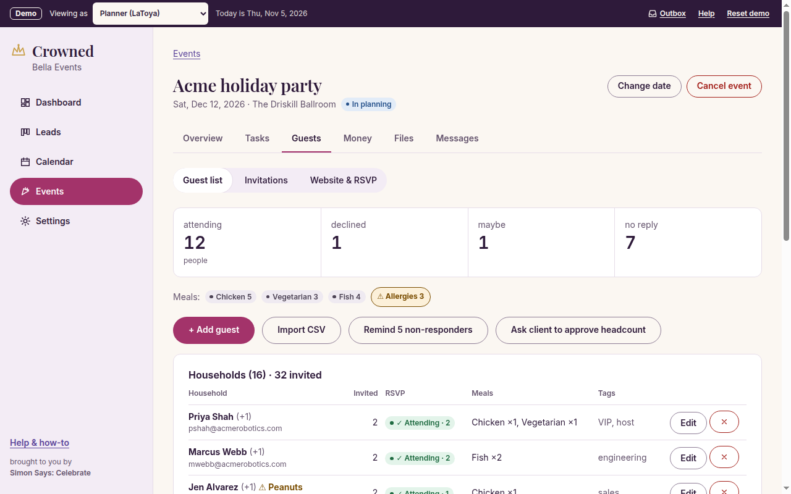

### 4. Website & RSVP, then invitations

Choose what the event website shows and what the RSVP asks (meals, allergies, songs, your own questions, plus-ones, privacy). Then write the invitation, get the client’s OK, and send it by email and text, now or scheduled. Tracking shows who got it, opened it and replied, and who didn’t get it.

**Try it:** open `/app/events/acme/guests/invitations`, or use **Show me** on the Help page.

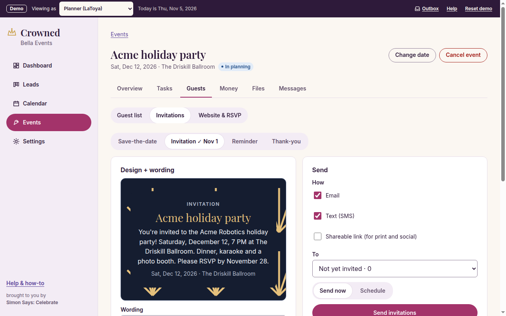

### 5. Money, files and messages

Money shows price, collected and balance (profit is owner-only). Files holds documents (shared or private) and the mood board. Messages has one thread with the client and one per vendor; send a change order right from the thread.

**Try it:** open `/app/events/acme/money`, or use **Show me** on the Help page.

### 6. Change the date or cancel

Change date checks your calendar, team and gear first, then moves every open task and payment date. Cancel shows the refund from your contract’s policy and asks you to type CANCEL.

**Try it:** open `/app/events/patel/reschedule`, or use **Show me** on the Help page.

### 7. Calendar

Month, week, day or list. Events, consults and dashed date holds, with a warning when you’re double-booked or travel time is too short.

**Try it:** open `/app/calendar`, or use **Show me** on the Help page.

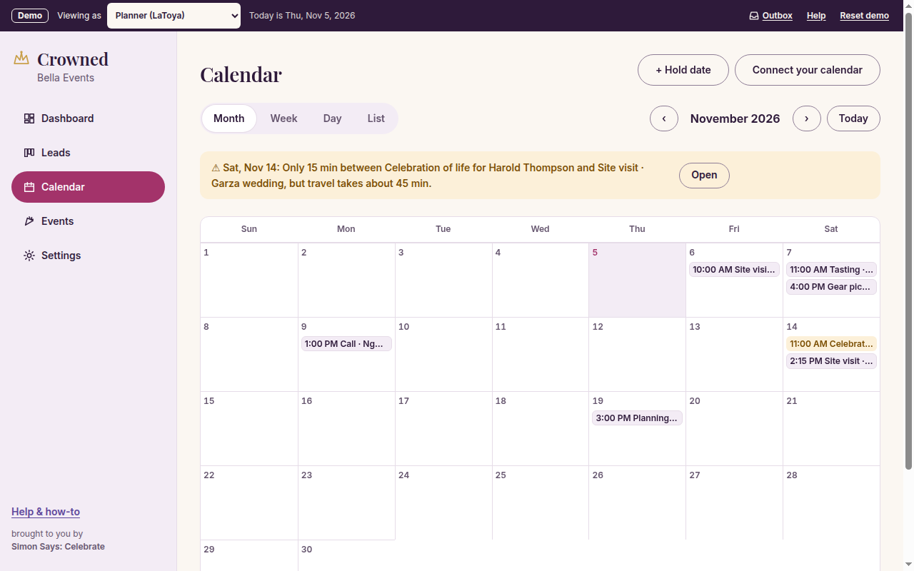

## Plan together (the client’s portal)

*Client.* After the deposit, clients get their own planning space. Priya (Acme) shows a portal in full swing.

### 1. Home: what’s next and what do I owe

A countdown, the next payment, and “Needs your action”, where every item links to the screen that finishes it. The first visit starts with a short tour.

**Try it:** open `/portal` (viewing as acme), or use **Show me** on the Help page.

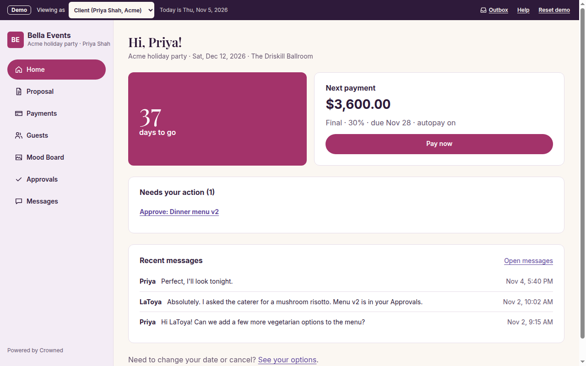

### 2. Questionnaire, mood board and approvals

Answers save as you go. Add photos and Pinterest links to the mood board and comment. Approve or request changes on the menu, invitation wording and final headcount.

**Try it:** open `/portal/approvals` (viewing as acme), or use **Show me** on the Help page.

### 3. Payments

See the balance and receipts, pay the next payment or the full balance, turn on autopay, and approve change orders.

**Try it:** open `/portal/payments` (viewing as acme), or use **Show me** on the Help page.

### 4. Guests and co-hosts

Add guests or import a spreadsheet; rows with problems are flagged so you can fix them before importing. Invite a partner or parent as a co-host.

**Try it:** open `/portal/guests` (viewing as acme), or use **Show me** on the Help page.

### 5. Messages, or a change of plans

Message the planner any time, even before booking. “Cancel or postpone” shows the policy and refund estimate before you ask.

**Try it:** open `/portal/messages` (viewing as acme), or use **Show me** on the Help page.

## RSVP (the guest’s side)

*Guest.* Guests never make an account. Their invitation link knows who they are.

### 1. Open the invitation

The text or email opens a card in the event’s theme with the date, time, place and reply-by date.

**Try it:** open `/i/acme-g8-t` (viewing as guest), or use **Show me** on the Help page.

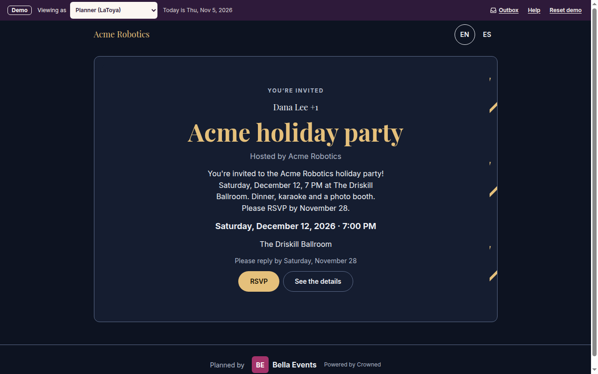

### 2. Read the event website

When and where with directions and Add to calendar, schedule, dress code, hotel, FAQ and registry. English or Spanish with one tap.

**Try it:** open `/e/acme?t=acme-g8-t` (viewing as guest), or use **Show me** on the Help page.

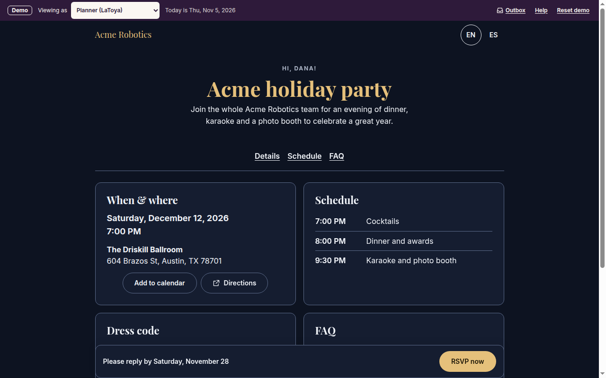

### 3. Reply for the household

Attending or not for each person, a meal each, allergies, a song request. Plus-ones only up to what the host allowed. The confirmation has “Change my RSVP”, which works until the cutoff.

**Try it:** open `/e/acme/rsvp?t=acme-g8-t` (viewing as guest), or use **Show me** on the Help page.

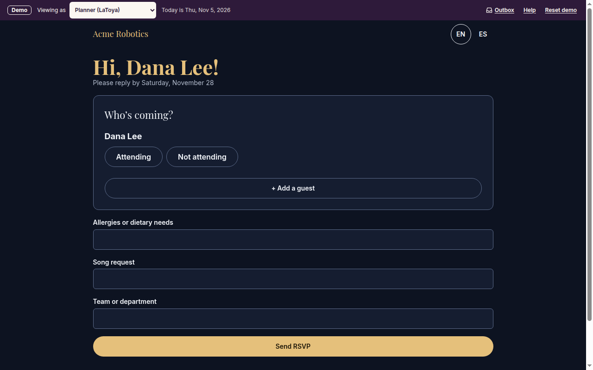

## Run your team

*Planner & staff.* Owners decide who sees what.

### 1. Invite and set permissions

Settings › Team & roles: invite by text or email with a role and job. Turn on budgets, payments or vendor editing per person. Profit is always owner-only. Deactivate keeps history; “Sign out everywhere” handles a lost phone.

**Try it:** open `/app/settings/team`, or use **Show me** on the Help page.

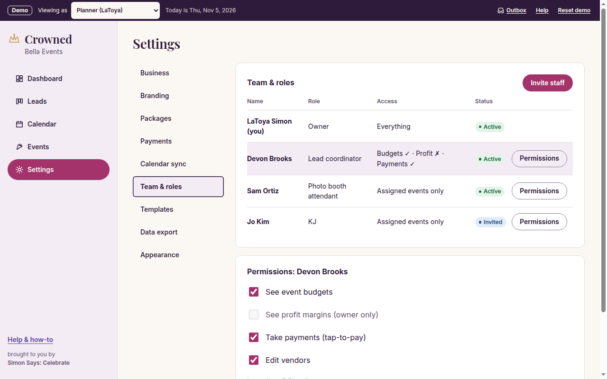

### 2. See what a teammate sees

Switch “Viewing as” to Coordinator (Devon): the Money tab hides profit. Sam (staff) can’t see money at all.

**Try it:** open `/app/events/acme/money` (viewing as devon), or use **Show me** on the Help page.

### 3. Join as staff

The invite text opens a sign-in with a phone number and a 6-digit code (demo code 123456), then the profile: photo, emergency contact, skills and shirt size.

**Try it:** open `/join/inv-jo` (viewing as staff), or use **Show me** on the Help page.

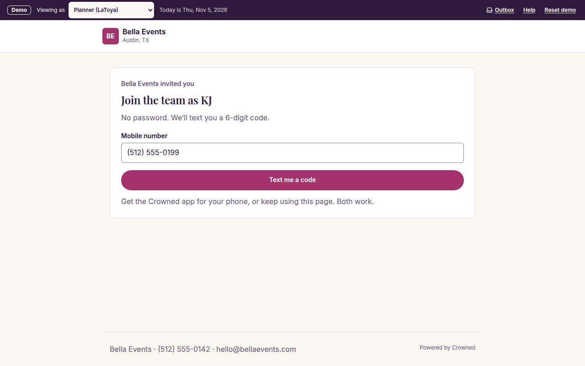

## Vendors, gear and the run of show

*Planner.* Event Hub › Logistics. The Acme holiday party has all of it filled in.

### 1. Build the run of show

Start from a template for the event type, then add cues with a time, who’s responsible and notes. Print it, or share it with staff and vendors. A cue that overlaps another is flagged.

**Try it:** open `/app/events/acme/logistics`, or use **Show me** on the Help page.

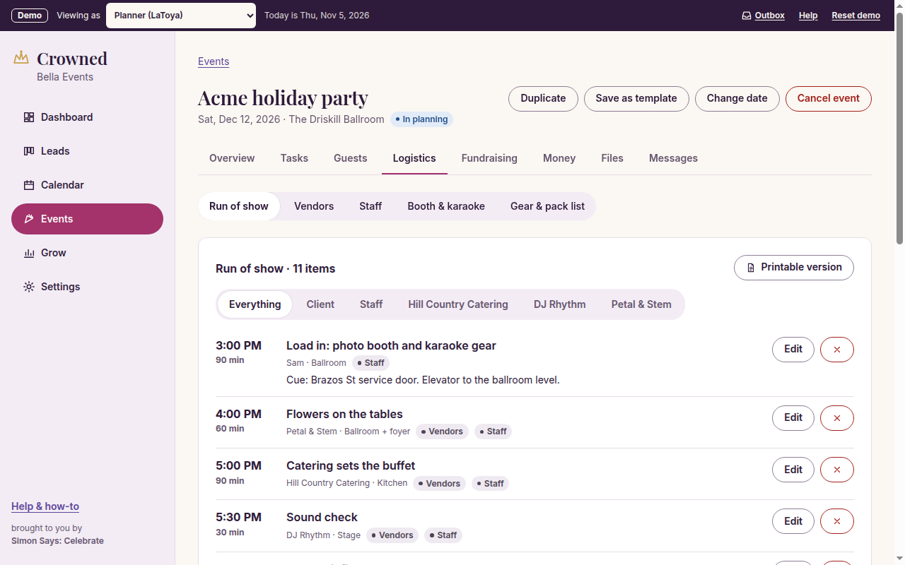

### 2. Book and pay vendors

Add a vendor from your directory, track the contract, insurance and W-9, and record payments (paid in the app by bank transfer, or by hand). Each vendor gets a magic link with their arrival time, the run of show and a message thread; they’re told automatically when the headcount locks or the date changes.

**Try it:** open `/app/events/acme/logistics/vendors`, or use **Show me** on the Help page.

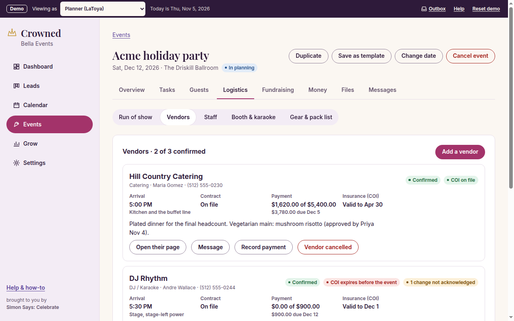

### 3. See it as the vendor

The vendor’s link needs no account: event details, their load-in, paperwork to upload, and messages with you.

**Try it:** open `/v/v-acme-hcc` (viewing as vendor), or use **Show me** on the Help page.

### 4. Reserve and pack gear

Countersigning reserves the equipment the proposal sold. Gear shows what’s reserved per event, with a buffer for cleaning, conflicts with other events, and a packing list built from kits plus the always-bring items.

**Try it:** open `/app/events/acme/logistics/gear`, or use **Show me** on the Help page.

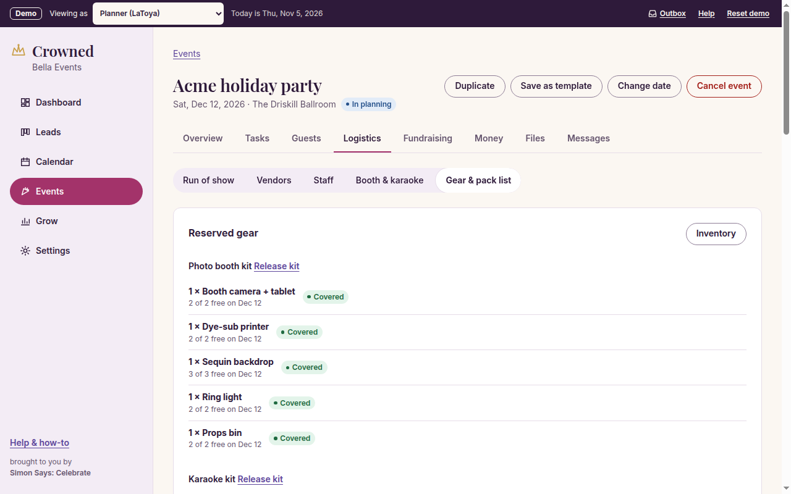

## Schedule staff (and the staff app)

*Planner & staff.* Shifts go out by text; staff answer from their phone.

### 1. Create shifts

Logistics › Staff: add a shift with a role and times. Crowned suggests who’s free and qualified and shows the labor cost. Offer it, then watch it be accepted, declined or swapped.

**Try it:** open `/app/events/acme/logistics/staff`, or use **Show me** on the Help page.

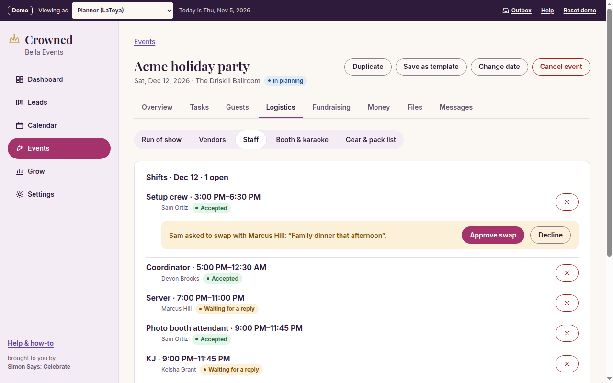

### 2. My shifts on the phone

Staff see their shifts, accept or decline, ask for a swap, set their availability, clock in and out at the venue, check off their packing list and chat with the team.

**Try it:** open `/app/staff/shifts` (viewing as staff), or use **Show me** on the Help page.

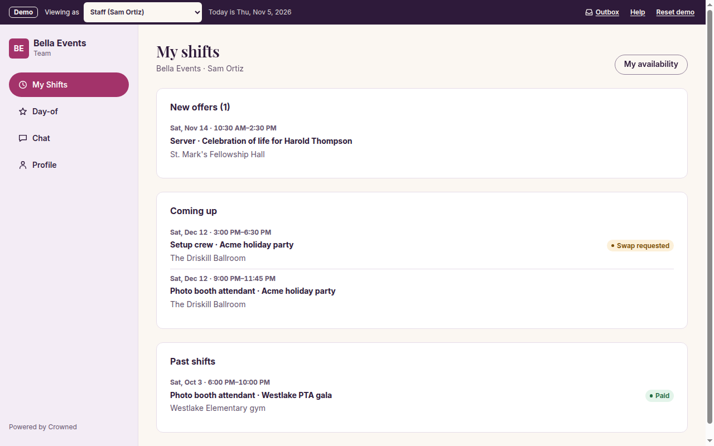

## Run the event day, then wrap up

*Planner.* The demo never reaches an event day, so each screen has a “Start event day” or practice button.

### 1. Day-of mode

One phone-friendly screen with live counts (guests checked in, vendors arrived, sales, booth and karaoke) and five tabs: Run (the cue that’s on “now” and what’s next), Door (check in guests and tickets by QR or name), Sell, Incidents and Teardown.

**Try it:** open `/app/day-of/acme`, or use **Show me** on the Help page.

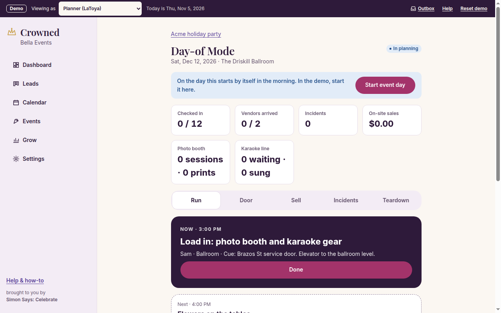

### 2. What the client sees on the day

Portal › Day of shows the schedule as it happens and who to call. Guests and photos come later.

**Try it:** open `/portal/day-of` (viewing as acme), or use **Show me** on the Help page.

### 3. Wrap-up

After teardown, the Wrap-up tab appears: return the gear (with damage notes), pay the last vendors, refund the security deposit, close the books, and send the review request and the guest survey.

**Try it:** open `/app/events/thompson/wrap-up`, or use **Show me** on the Help page.

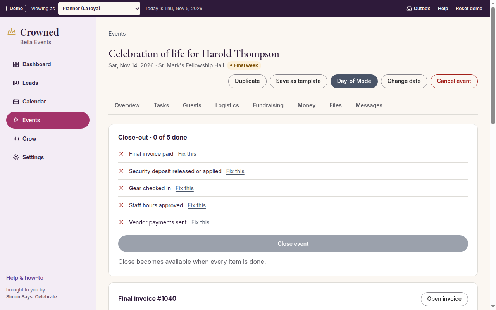

## Potluck and volunteer sign-ups

*Planner & guest.* For community events. The Hope dinner uses both.

### 1. Set up the sign-up

Guests › Potluck: choose categories with how many of each you need, and volunteer slots. The sheet shows what’s still missing and who brings what, with dietary tags.

**Try it:** open `/app/events/hope/guests/potluck`, or use **Show me** on the Help page.

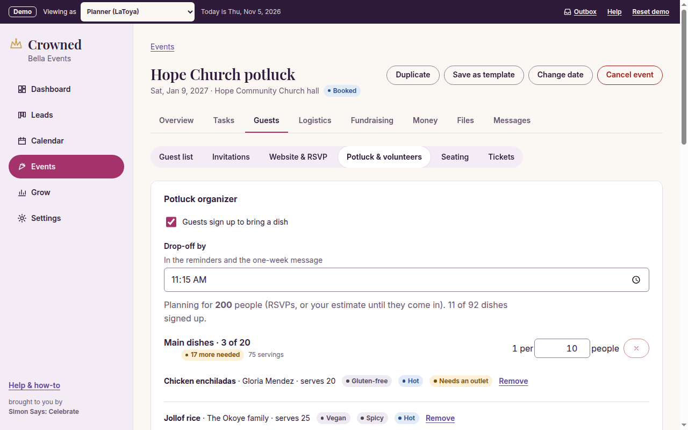

### 2. Guests sign up

From the event website: pick a dish or a slot, tag it (vegan, nut-free…), and get a reminder. No account, English or Spanish.

**Try it:** open `/e/hope/potluck` (viewing as guest), or use **Show me** on the Help page.

## Karaoke

*Planner & guest.* Logistics › Booth & karaoke turns it on for an event; your KJ runs the show.

### 1. Guests request songs

Guests scan the QR code and search the song list or request a song. They see their place in line.

**Try it:** open `/e/acme/karaoke` (viewing as guest), or use **Show me** on the Help page.

### 2. The KJ console

Approve requests, reorder the queue, skip, and mark “now singing”. The big screen shows who’s up next and the QR code to join.

**Try it:** open `/app/kj/acme`, or use **Show me** on the Help page.

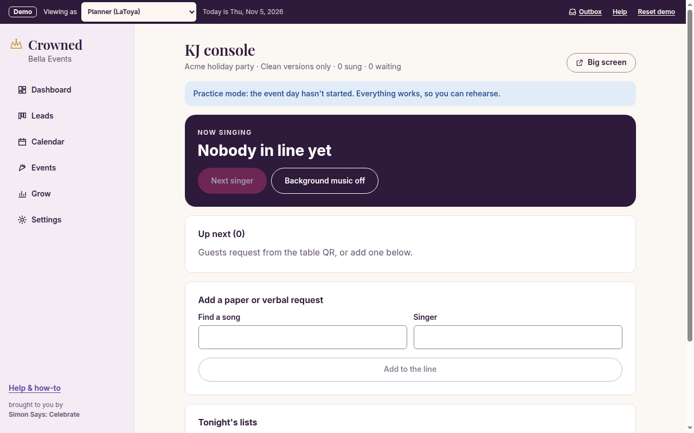

## Photo booth and galleries

*Planner & guest.* The booth runs on a tablet at the event; photos flow into a live gallery.

### 1. Set up the booth

Pick overlays and magnet frames, print settings and a PIN for the attendant. Logistics › Booth & karaoke links to the kiosk and the attendant screen.

**Try it:** open `/app/booth/acme`, or use **Show me** on the Help page.

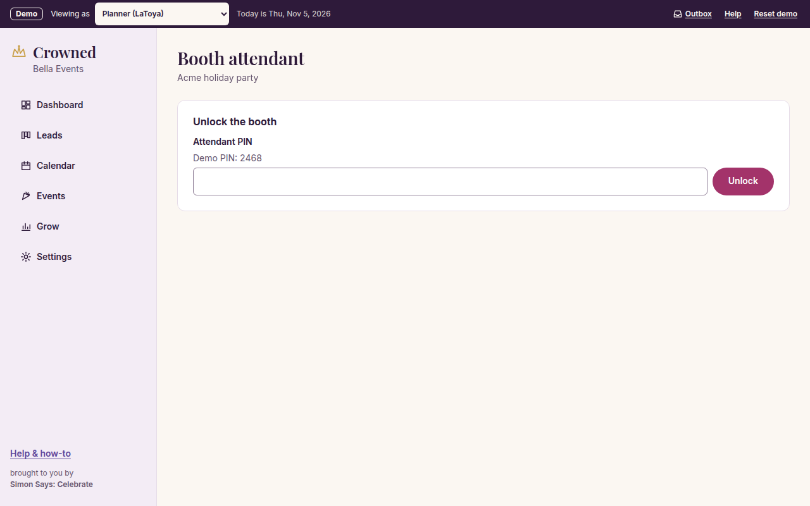

### 2. The kiosk

Guests tap to start, strike a pose, and send their photo to their phone. The attendant (PIN 2468) reprints and prints magnets.

**Try it:** open `/booth/acme`, or use **Show me** on the Help page.

### 3. Galleries and thank-yous

Guests browse and download the gallery from the event website; the client gets the full gallery and a thank-you note list in the portal.

**Try it:** open `/e/westlake/gallery` (viewing as guest), or use **Show me** on the Help page.

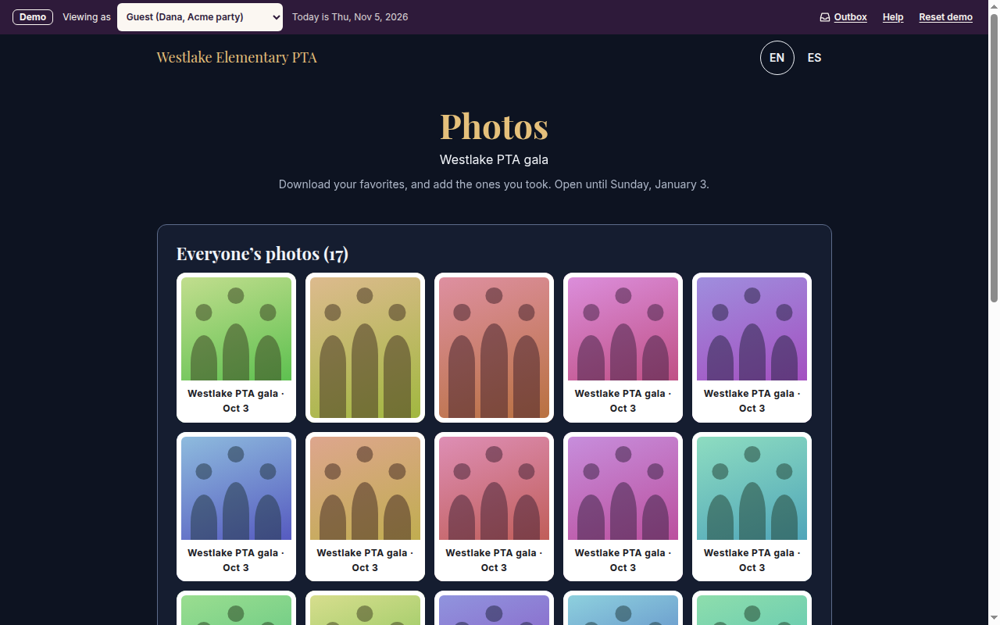

## Design the invitation

*Planner.* Guests › Design: start from a layout in the event’s theme.

### 1. Lay out the card

Choose a layout, colors, fonts and a photo, then edit the words. Preview it as the envelope guests open, as an email and as a printable card, then send it for the client’s approval.

**Try it:** open `/app/events/garza/guests/design`, or use **Show me** on the Help page.

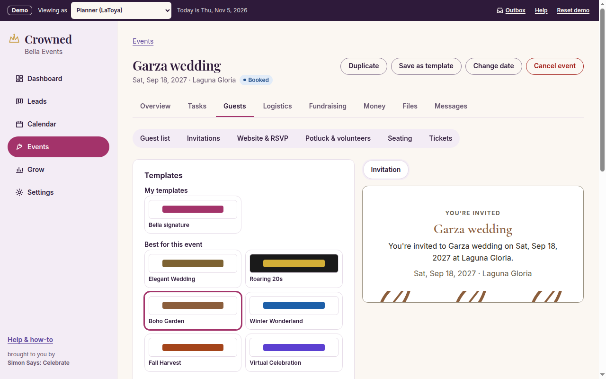

## Fundraising: donations, auction and sponsors

*Planner & guest.* Event Hub › Fundraising. The Hope dinner raises money for a cause.

### 1. Set the goal

Turn on donations, a silent auction, a paddle raise and sponsorship levels. The tab shows progress to the goal, bids, pledges and receipts (with the tax-deductible amount).

**Try it:** open `/app/events/hope/fundraising`, or use **Show me** on the Help page.

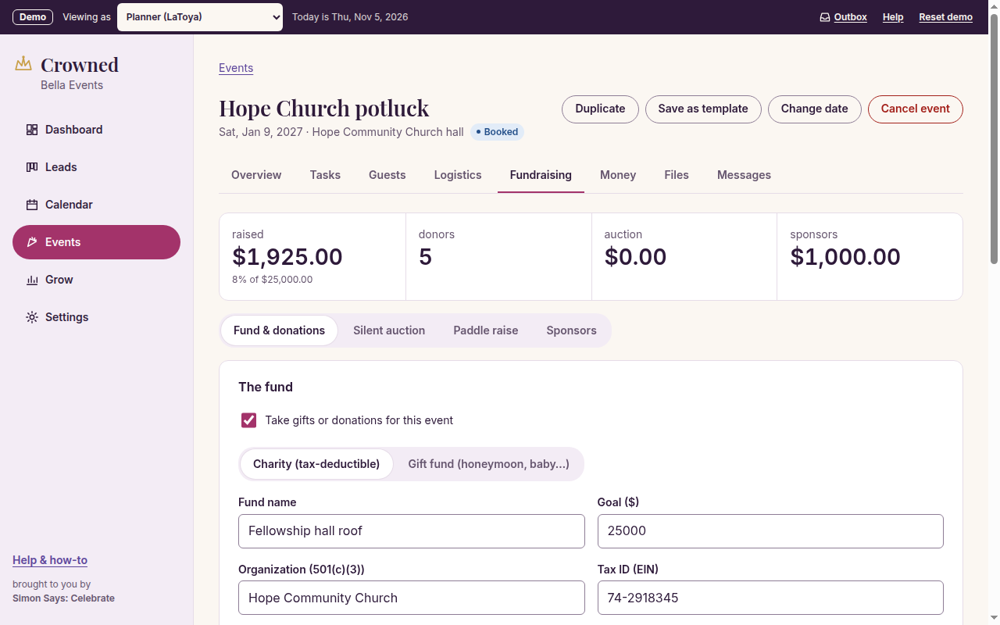

### 2. Guests give and bid

From their phone: give, bid on auction items (outbid alerts), pledge during the paddle raise, or sponsor. A double tap never charges twice. The venue screen shows the live total.

**Try it:** open `/e/hope/auction` (viewing as guest), or use **Show me** on the Help page.

## Tickets, floor plan and seating

*Planner & guest.* Sell tickets for public events; seat guests for any event.

### 1. Sell tickets

Guests › Tickets: tiers with capacity, promo codes and a waitlist. Each buyer gets a QR ticket, scanned at the door on Day-of.

**Try it:** open `/app/events/hope/guests/tickets`, or use **Show me** on the Help page.

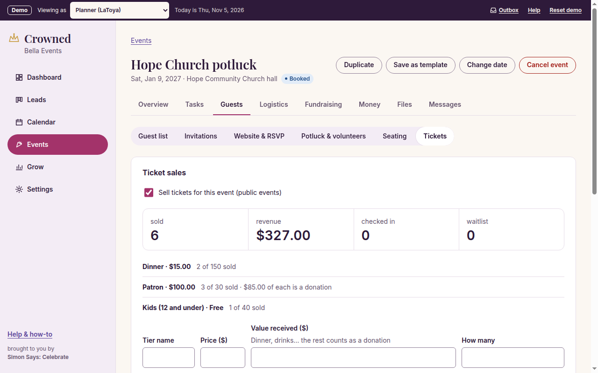

### 2. Draw the floor plan and seat guests

Drag tables, the stage and the dance floor (or use the arrow keys), then seat each household. Tables warn about “don’t seat near”, meals and allergies. Print escort cards, table numbers and place cards.

**Try it:** open `/app/events/acme/guests/seating`, or use **Show me** on the Help page.

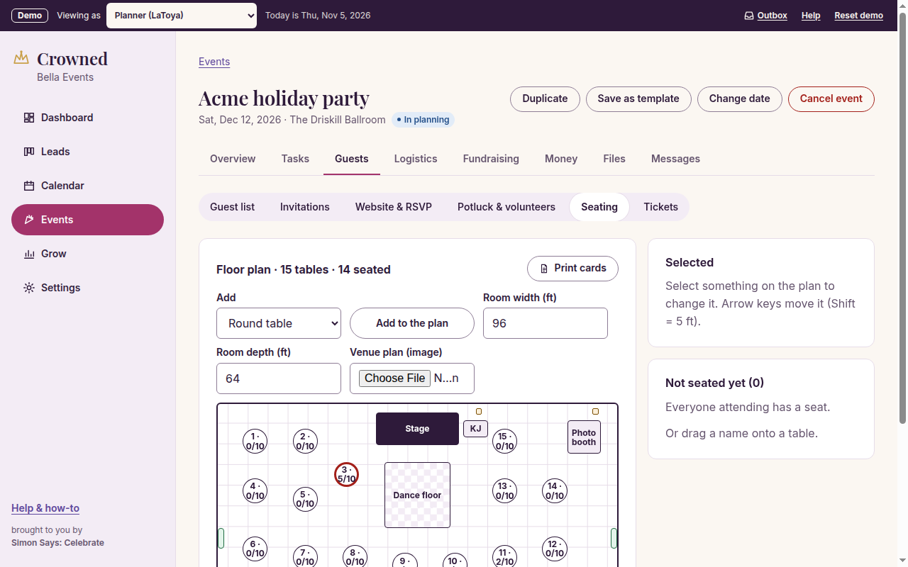

### 3. Guests find their seat

Type a name to see the table lit up on a small map.

**Try it:** open `/e/acme/seat?t=acme-g1-t` (viewing as guest), or use **Show me** on the Help page.

## Grow the business

*Planner.* Grow, in the planner menu.

### 1. Reports

Booked vs collected by month, lead sources, best-selling add-ons, gear use and sales tax by city. “Show as table” on every chart. Connect QuickBooks to sync invoices and payments.

**Try it:** open `/app/grow`, or use **Show me** on the Help page.

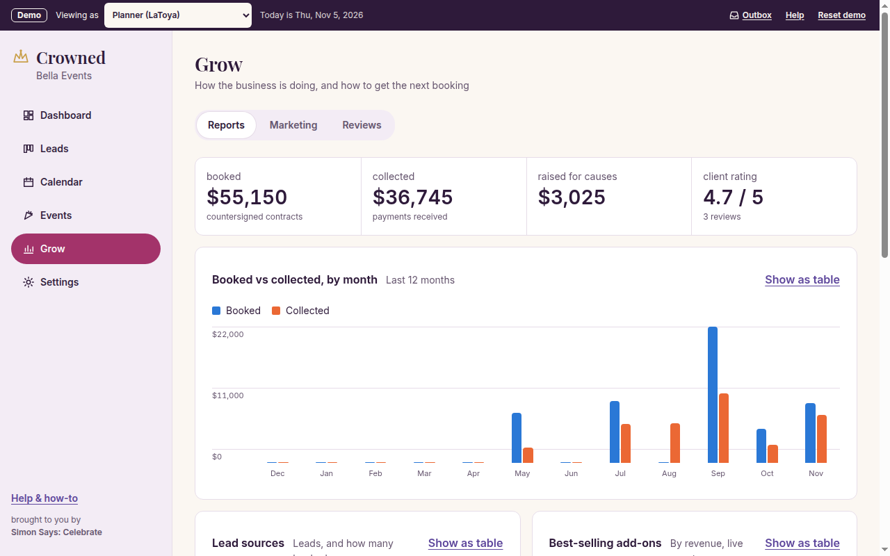

### 2. Marketing reminders

For past clients who opted in, Crowned reminds you about two months before a key date (an anniversary, a first birthday) so you can send a note. Memorial families are never marketed to.

**Try it:** open `/app/grow?tab=marketing`, or use **Show me** on the Help page.

### 3. Duplicate and templates

In an event’s header, Duplicate copies it to a new date; Save as template keeps its tasks, timeline and gear for next time (Settings › Templates).

**Try it:** open `/app/settings/templates`, or use **Show me** on the Help page.

### 4. Reviews

The client gets one-tap links to Google, Yelp, The Knot and WeddingWire plus a private rating; guests answer one question. Grow › Reviews collects them.

**Try it:** open `/portal/review` (viewing as acme), or use **Show me** on the Help page.

## Tips

- The Outbox is your best friend in the demo: open any message and press its button to see the screen as that person.
- “Reset demo” in the top bar starts over. So does refreshing the page.
- Try the whole Rivera story: Outbox → “Your proposal (v2) is ready” → accept, sign, pay → switch to the planner → Countersign on the Dashboard.
- Calm or Bold? Settings › Appearance switches the whole app’s look; guest pages always wear the event’s own theme.
- Everything works on a phone: the menu moves to the bottom bar, with “More” for the rest.
